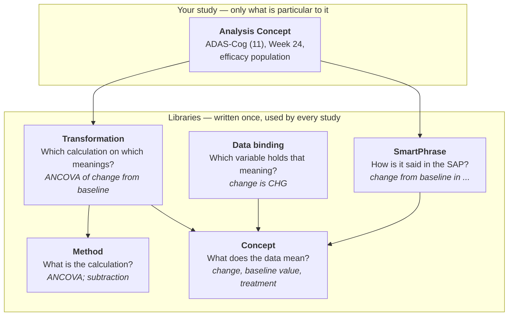

# 2. One analysis, five artefacts

[Guide index](README.md) · Previous: [1. Getting started](01-getting-started.md) · Next: [3. Methods](03-methods.md)

**You will learn** the example used throughout the guide, as it appears in the
documents you already work with, and what problem Analysis Concepts solves.

## The analysis

The study is the CDISC Pilot (CDISCPILOT01): xanomeline against placebo in mild
to moderate Alzheimer's disease. Its primary efficacy analysis compares the
change in the ADAS-Cog (11) score from baseline to Week 24 between treatment
groups, by analysis of covariance.

> The example study in this repository is a simplified version of the published
> pilot. It keeps the endpoint, the visit, the population and the method. It
> leaves out site as a covariate and the dose-response test. Chapter 14 says
> why.

Here is that one analysis in five artefacts. Every data value is made up.

### 1. The SAP

> Change from baseline in ADAS-Cog (11) at Week 24 will be analysed in the
> efficacy population using an ANCOVA model with treatment as a factor and
> baseline ADAS-Cog (11) as a covariate. Least-squares means, differences from
> placebo and 95% confidence intervals will be presented.

### 2. The table shell

```
Table 14.2.1   ADAS-Cog (11): Change from Baseline to Week 24 (ANCOVA)
               Efficacy Population

                                  Placebo     Xanomeline    Xanomeline
                                               Low Dose      High Dose
                                  (N=xx)       (N=xx)        (N=xx)
------------------------------------------------------------------------
Change from baseline at Week 24
  LS mean (SE)                    x.x (x.xx)   x.x (x.xx)    x.x (x.xx)
  95% CI                          (x.x, x.x)   (x.x, x.x)    (x.x, x.x)

Difference from placebo
  LS mean difference (SE)                      x.x (x.xx)    x.x (x.xx)
  95% CI                                       (x.x, x.x)    (x.x, x.x)
  p-value                                      0.xxx         0.xxx
------------------------------------------------------------------------
```

### 3. The analysis dataset

`ADQSADAS`, a BDS dataset, one record per subject, parameter and analysis
visit.

| USUBJID | PARAMCD | AVISIT | AVISITN | AVAL | BASE | CHG | ABLFL | TRTP | ITTFL |
| --- | --- | --- | --- | --- | --- | --- | --- | --- | --- |
| 01-701-1015 | ACTOT | Baseline | 0 | 12 | 12 | | Y | Placebo | Y |
| 01-701-1015 | ACTOT | Week 8 | 8 | 13 | 12 | 1 | | Placebo | Y |
| 01-701-1015 | ACTOT | Week 24 | 24 | 15 | 12 | 3 | | Placebo | Y |
| 01-701-1023 | ACTOT | Baseline | 0 | 20 | 20 | | Y | Xanomeline High Dose | Y |
| 01-701-1023 | ACTOT | Week 24 | 24 | 17 | 20 | -3 | | Xanomeline High Dose | Y |

### 4. The program

```sas
proc glm data=adam.adqsadas;
  where PARAMCD = 'ACTOT' and AVISITN = 24 and ITTFL = 'Y';
  class TRTP;
  model CHG = BASE TRTP / ss3 solution;
  lsmeans TRTP / pdiff cl alpha=0.05;
run;
```

### 5. define.xml

Two parts of define.xml describe this analysis. Value-level metadata says what
`AVAL` holds when `PARAMCD` is `ACTOT`, and how `CHG` is derived. Analysis
results metadata describes the table:

| Analysis results metadata | Value |
| --- | --- |
| Display | Table 14.2.1 |
| Analysis reason | SPECIFIED IN SAP |
| Analysis purpose | PRIMARY OUTCOME MEASURE |
| Analysis dataset | ADQSADAS |
| Where clause | PARAMCD EQ ACTOT and AVISITN EQ 24 and ITTFL EQ Y |
| Analysis variable | CHG |
| Documentation | ANCOVA of change from baseline with treatment and baseline as … |
| Programming code | `proc glm …` |

## The problem

Look at what these five artefacts have in common. Seven facts define the
analysis, and each is written down in almost every artefact, in a different
form each time.

| Fact | SAP | Shell | Dataset | Program | define.xml |
| --- | --- | --- | --- | --- | --- |
| The parameter is ADAS-Cog (11) | "ADAS-Cog (11)" | title | `PARAMCD = 'ACTOT'` | `where PARAMCD = 'ACTOT'` | where clause |
| The visit is Week 24 | "at Week 24" | title | `AVISITN = 24` | `where … AVISITN = 24` | where clause |
| The population is efficacy | "efficacy population" | subtitle | `ITTFL = 'Y'` | `where … ITTFL = 'Y'` | where clause |
| The response is change from baseline | "change from baseline" | row label | `CHG` | `model CHG = …` | analysis variable |
| The covariate is baseline | "baseline … as a covariate" | — | `BASE` | `… = BASE …` | documentation |
| The groups are the treatment arms | "treatment as a factor" | columns | `TRTP` | `class TRTP` | documentation |
| The method is ANCOVA | "ANCOVA model" | title | — | `proc glm` | documentation, code |

Three things follow.

- **The same fact is typed many times.** When the population changes, five
  documents change, by hand.
- **Nothing connects them.** No program can check that the SAP, the shell and
  the code say the same thing. A reviewer does it by reading.
- **Nothing is reusable.** The next study's ANCOVA of a different parameter
  starts from a copy of this one.

The published pilot shows how this goes wrong. Its SAP says the analysis is of
"ADAS-Cog (11) at Week 24". Only define.xml reveals that the variable analysed
was the *change* from baseline.

## What Analysis Concepts does about it

It records each of the seven facts once, in a structured form, and separates
them by the question they answer.



Those five boxes on the left are the **five layers** of the model. The next
four chapters take them one at a time, starting with the one closest to what
you already do: the calculation.

Then chapter 7 shows the box on the right, where your study says "ADAS-Cog
(11), Week 24, efficacy population" exactly once, and chapter 12 shows the five
artefacts above being generated from it.

## What to take away

- One analysis is described in at least five documents, and the same seven
  facts appear in each.
- AC records each fact once and separates *calculation*, *meaning*, *pattern*,
  *variables* and *wording*.
- Reusable content lives in libraries. A study states only its own choices.

Next: [3. Methods](03-methods.md)
