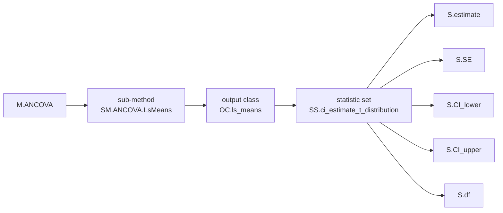

# 3. Methods

[Guide index](README.md) · Previous: [2. One analysis, five artefacts](02-one-analysis-five-artefacts.md) · Next: [4. Concepts](04-concepts.md)

**You will learn** how a calculation is described on its own, with no dataset
and no variable in sight.

## The idea

Take the program from chapter 2 and remove everything that belongs to the
study:

```sas
proc glm data=________;
  where ________;
  class ________;
  model ________ = ________ ________ / ss3 solution;
  lsmeans ________ / pdiff cl;
run;
```

What is left is the *method*: an analysis of covariance, which needs a
response, a covariate and a grouping factor, and gives back LS means,
differences and tests. A **Method** in Analysis Concepts is exactly that, with
the blanks given names.

A Method never mentions `CHG`, `ADQSADAS` or even "change from baseline". That
is what makes it reusable.

## A small Method first: subtraction

Change from baseline is a subtraction. Here is the whole Method, from
`v1/lib/methods/derivations/M.Subtraction.json`:

```json
{
  "conceptId": "M.Subtraction",
  "name": "Subtraction",
  "description": "Computes the difference between two numeric values",
  "methodType": "DerivationMethod",
  "inputs": [
    { "inputType": "ContinuousVariable", "role": "minuend",
      "description": "The value to subtract from",
      "dataType": "decimal", "required": true, "multivalued": false },
    { "inputType": "ContinuousVariable", "role": "subtrahend",
      "description": "The value to subtract",
      "dataType": "decimal", "required": true, "multivalued": false }
  ],
  "formula": {
    "notation": "derivation",
    "text": "result := <minuend> - <subtrahend>"
  },
  "output": { "outputClass": "OC.computed_value", "dataType": "decimal", "…": "…" }
}
```

Read it as a function signature:

| Part | Meaning |
| --- | --- |
| `conceptId` | Its identifier. Every Method starts with `M.` |
| `inputs` | The blanks. Each has a **role**: a name that the formula uses |
| `formula.text` | The calculation, with the roles in angle brackets |
| `output` | What comes back: here, one computed value |

The roles are `minuend` and `subtrahend`, not "value" and "baseline". The
Method does not know what is being subtracted from what. Something else will
say so, in chapter 5.

## A statistical Method: ANCOVA

`v1/lib/methods/analyses/M.ANCOVA.json` is longer, but has the same parts.

### Inputs

| Role | Kind | Required | Several allowed |
| --- | --- | --- | --- |
| `response` | continuous | yes | no |
| `covariate` | continuous | no | yes |
| `fixed_effect` | categorical | yes | yes |

Each input says whether it is continuous or categorical. A categorical input
has levels, so that results can be reported per level (per treatment arm).

### Formula

The model is written in Wilkinson–Rogers notation, the notation of R model
formulas and, give or take punctuation, of a SAS `MODEL` statement:

```
<response> ~ <covariate>* + <fixed_effect>+ + (<fixed_effect>:<fixed_effect>)* + (<covariate>:<fixed_effect>)*
```

`*` means "none or more", `+` means "one or more", and `a:b` is an
interaction. In its commonest form: `response ~ covariate + fixed_effect`.

### Configurations

The options of the method, each with allowed values and a default.

| Configuration | Meaning | Default |
| --- | --- | --- |
| `ss_type` | Type of sums of squares (I, II, III, IV) | III |
| `alpha` | Type I error rate; 1 − alpha is the confidence level | 0.05 |

### Outputs

A model-based method produces several outputs. Each is a **sub-method** of the
Method. If you use SAS, they will look familiar: they are the ODS tables.

| Sub-method | What it is | Statistics | `PROC GLM` ODS table |
| --- | --- | --- | --- |
| `SM.ANCOVA.LsMeans` | Least-squares means, per level | estimate, SE, CI_lower, CI_upper, df | `LSMeans` |
| `SM.ANCOVA.ContrastsT` | Differences between levels | estimate, SE, CI_lower, CI_upper, df, t_statistic, p_value | `LSMeanDiffCL` |
| `SM.ANCOVA.Type3TestsF` | One test per model term | SS, MS, F_statistic, df_num, df_den, p_value | `ModelANOVA` |
| `SM.ANCOVA.ParameterEstimatesLinear` | One row per coefficient | coefficient, SE, CI_lower, CI_upper, df, t_statistic, p_value | `ParameterEstimates` |
| `SM.ANCOVA.FitStatisticsLinear` | Model fit | R_squared, AIC, BIC, minus2LogL | `FitStatistics` |

Look back at the table shell in chapter 2. "LS mean (SE)" and "95% CI" come
from `SM.ANCOVA.LsMeans`. "LS mean difference", its interval and the p-value
come from `SM.ANCOVA.ContrastsT`. The shell is a selection of statistics from
two outputs of one Method.

## Three small vocabularies

The statistics in that table are not free text. They come from three small
libraries in `v1/lib/statistics/`, so that "p-value" means the same thing in
every Method.

| Vocabulary | What it holds | Example | Identifier |
| --- | --- | --- | --- |
| Statistics | One value a method can produce | the standard error | `S.SE` |
| Statistic sets | Statistics that are read together | an estimate with its interval, SE and degrees of freedom | `SS.ci_estimate_t_distribution` |
| Output classes | A kind of output and the statistics it carries | least-squares means | `OC.ls_means` |



You will rarely need to edit these. It is enough to know that every number in
a table can be traced to a named statistic.

## The three kinds of Method

| Kind | What it does | Examples | Result |
| --- | --- | --- | --- |
| Derivation | Computes a value for each record | Subtraction, percent change, LOCF imputation, date difference | Subject-level data |
| Aggregation | Summarises many values into one | Mean, median, count, standard deviation | One value per group |
| Model-based | Fits a model or runs a test | ANCOVA, MMRM, Cox regression, Kaplan-Meier, log-rank | Several outputs (sub-methods) |

The library holds 60 Methods: 21 derivation, 25 aggregation and 14
model-based. They are listed in `v1/lib/methods/_index.json`.

## The rule for this layer

> A Method names no Concept and no variable.

This is checked. If someone writes `CHG` or "change from baseline" into a
Method, the validator reports an error (rule L1 in
[conformance.md](../conformance.md)).

## Try it

Open `v1/lib/methods/analyses/M.KaplanMeier.json`. Find its three inputs and
its four sub-methods. Which sub-method would give you the "Median (95% CI)" row
of a time-to-event table? (Answer in chapter 10.)

## What to take away

- A Method is a calculation with named blanks, called **roles**.
- A model-based Method has **sub-methods**, one per output, each carrying named
  **statistics**.
- A Method knows nothing about your study, your data or what the data means.

So far nothing says that the `response` is a change from baseline. For that we
need a way to talk about what data *means*.

Next: [4. Concepts](04-concepts.md)
