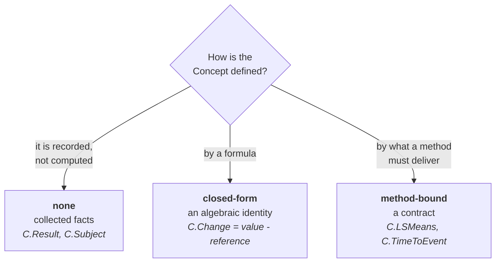

# 4. Concepts

[Guide index](README.md) · Previous: [3. Methods](03-methods.md) · Next: [5. Transformations](05-transformations.md)

**You will learn** how the *meaning* of data is described, separately from the
variable that happens to hold it.

## Why variables are not enough

In a BDS dataset, what does `AVAL` hold?

| PARAMCD | AVAL is … |
| --- | --- |
| `ACTOT` | an ADAS-Cog (11) total score |
| `PFS` | days from randomisation to progression or death |
| `AECOUNT` | a number of adverse events |

`AVAL` is a place, not a meaning. A standard derivation cannot say "subtract
`BASE` from `AVAL`", because that is true only in ADaM, only in BDS, and only
for some parameters. In SDTM the same value is in `--STRESN`.

A **Concept** is the meaning, with no place attached: "a measured value", "a
change", "a treatment".

## What a Concept looks like

From `v1/lib/concepts/concepts.json`:

```json
{
  "conceptId": "C.Change",
  "name": "Change",
  "conceptRole": "derived",
  "axis": "measure",
  "description": "The arithmetic difference between two values of the same parameter.",
  "examples": ["change from baseline in SBP", "inter-visit difference in weight"],
  "result": { "valueTypes": ["Quantity"], "unitRule": "inherited" },
  "definitionForm": "closedForm",
  "algebraicDefinition": {
    "operands": [ { "name": "value" }, { "name": "reference" } ],
    "identity": "result = value - reference"
  }
}
```

Notice what is *not* there: no `CHG`, no dataset, no standard. Notice also that
it does not say "from baseline". A change from baseline and a change between
two visits are the same Concept; the reference visit is chosen later.

## Two questions every Concept answers

### Where in the data lifecycle does it arise?

| `conceptRole` | Meaning | Examples | You meet it in |
| --- | --- | --- | --- |
| `collected` | A recorded fact | `C.Result`, `C.Dose`, `C.Severity`, `C.Subject` | SDTM |
| `derived` | A subject-level value computed from others | `C.Measure`, `C.Change`, `C.TimeToEvent`, `C.Flag` | ADaM |
| `analysis` | An aggregate statistical result | `C.LSMeans`, `C.Contrasts`, `C.MedianSurvival` | Tables and results datasets |

### What part does it play?

Think of a BDS dataset. Some variables say *which* observation a record is, and
some hold the value.

| `axis` | Meaning | BDS variables that carry such Concepts |
| --- | --- | --- |
| `dimension` | Identifies or groups observations | `USUBJID`, `PARAMCD`, `AVISIT`, `TRTP`, population flags |
| `measure` | A value that is computed on | `AVAL`, `BASE`, `CHG` |
| `attribute` | Qualifies an observation; never computed on | `AVALU`, `DTYPE` |

This distinction is the one programmers already make without naming it. A
dimension ends up in a `WHERE`, a `BY` or a `CLASS` statement. A measure ends
up in a `MODEL` statement or a function call.

## The Concepts of the running example

These are all the Concepts the primary analysis of chapter 2 needs.

| Concept | Role | Axis | In plain words |
| --- | --- | --- | --- |
| `C.Subject` | collected | dimension | The person |
| `C.Parameter` | collected | dimension | Which measurement (ADAS-Cog (11)) |
| `C.AnalysisVisit` | derived | dimension | Which analysis visit (Week 24) |
| `C.Population` | derived | dimension | Membership of an analysis population |
| `C.Treatment` | collected | dimension | The treatment group |
| `C.Measure` | derived | measure | A value for analysis (the score) |
| `C.Change` | derived | measure | A difference between two values |
| `C.LSMeans` | analysis | measure | Least-squares means |
| `C.Contrasts` | analysis | measure | Differences between LS means |

## How Concepts are defined

A Concept is defined in one of three ways.



**Closed-form.** `C.Change` above carries its own identity,
`result = value - reference`. So do `C.PercentChange`, `C.Ratio` and
`C.LogRatio`.

**Method-bound.** Some Concepts cannot be written as a formula. An area under a
curve, a count of events, an LS mean: each is the result of a procedure. Such a
Concept states a *contract* instead: what a method must deliver for its output
to count as this Concept.

```json
{
  "conceptId": "C.LSMeans",
  "conceptRole": "analysis",
  "definitionForm": "methodBound",
  "description": "Least-squares means (adjusted marginal means) per factor level or level combination",
  "methodBoundDefinition": {
    "constituents": ["S.CI_lower", "S.CI_upper", "S.df", "S.estimate", "S.SE"],
    "satisfiedBy": ["OC.ls_means"]
  }
}
```

In words: *anything that gives an estimate, a standard error, a confidence
interval and degrees of freedom is an LS mean*. Compare this with the
statistics of `SM.ANCOVA.LsMeans` in chapter 3. They match. That match is how
the model knows that ANCOVA can produce LS means, and it is checked.

Notice that the Concept does not name ANCOVA. Any method whose output carries
those statistics satisfies it: an MMRM does too.

## Groups of Concepts

Some Concepts are groupings. They are marked `abstract`, and other Concepts
belong to them through `broader`.

| Grouping | Members | Why it exists |
| --- | --- | --- |
| `C.ParameterDimension` | `C.Parameter` | A standard analysis says "for some parameter" without saying which |
| `C.VisitDimension` | `C.Visit`, `C.AnalysisVisit`, `C.Timepoint` | "At some visit" |
| `C.EventDimension` | `C.Event` | "For some event" (time-to-event) |
| `C.Comparison` | `C.Change`, `C.PercentChange`, `C.Ratio`, `C.Shift` … | Kinds of derived value |
| `C.TreatmentComparison` | `C.LSMeans`, `C.Contrasts`, `C.Type3Tests` … | Kinds of result |

You will see `C.ParameterDimension` and `C.VisitDimension` in the next chapter.
They are how a library says "the parameter and the visit are up to the study".

## One library, three origins

The library holds 108 Concepts in one file. They came from three separate
models, which is worth knowing because the older names still appear in
presentations:

| Older name | Now | Count |
| --- | --- | --- |
| Observation Concepts | `collected` Concepts | 58 |
| Derivation Concepts | `derived` Concepts | 34 |
| Analysis Concepts (as a list of result patterns) | `analysis` Concepts | 16 |

How a collected Concept relates to a CDISC Biomedical Concept is covered in
[chapter 11](11-other-standards.md).

## The rule for this layer

> A Concept holds no variable and names no Method.

A Concept that said "I am `CHG`" would work only for ADaM. A Concept that said
"I am made by ANCOVA" could not be produced by an MMRM. Both are errors (rule
L2).

## Try it

Search `v1/lib/concepts/concepts.json` for `C.TimeToEvent`. Is it collected,
derived or analysis? Is it defined by a formula or by a contract? (It is
derived and method-bound: time to an event depends on how events and censoring
are worked out, which is a procedure.)

## What to take away

- A Concept is a meaning with no variable attached.
- It is `collected`, `derived` or `analysis`, and plays the part of a
  `dimension`, a `measure` or an `attribute`.
- It is defined by nothing, by a formula, or by a contract of statistics.
- Abstract Concepts stand for "some parameter" or "some visit".

We now have calculations with named blanks (Methods) and meanings with no
variables (Concepts). The next chapter puts one into the other.

Next: [5. Transformations](05-transformations.md)
