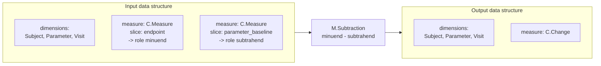
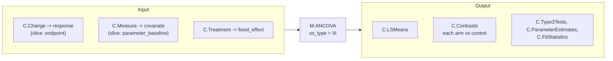
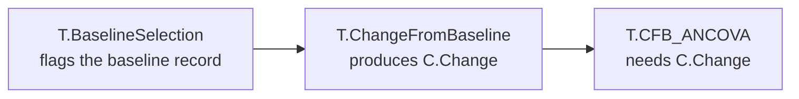

# 5. Transformations

[Guide index](README.md) · Previous: [4. Concepts](04-concepts.md) · Next: [6. Data bindings](06-data-bindings.md)

**You will learn** how a Method and Concepts are joined into a reusable
derivation or analysis, and how the "which records?" question is answered.

## The idea

A Method has blanks. Concepts are meanings. A **Transformation** fills the
blanks of one Method with Concepts, for a stated purpose.

| | Method | + Concepts | = Transformation |
| --- | --- | --- | --- |
| Derivation | Subtraction | a value, minus the baseline value, gives a change | Change from baseline |
| Analysis | ANCOVA | change as the response, baseline as the covariate, treatment as the factor | ANCOVA of change from baseline |

A Transformation is what your organisation would call a *standard derivation*
or a *standard analysis*. It is still not about any study: it does not say
which parameter, which visit or which population.

## A derivation: change from baseline

`T.ChangeFromBaseline`, from `v1/lib/transformations/transformations.json`.
First, which Method and which Concepts:

| Method role (`M.Subtraction`) | Bound to Concept | Which records |
| --- | --- | --- |
| `minuend` | `C.Measure` | the value at the visit of interest |
| `subtrahend` | `C.Measure` | the value at the baseline visit |
| *(output)* | `C.Change` | |

Both inputs are the same Concept, `C.Measure`. What differs is *which records*
each one takes. That is the new idea in this chapter.

## Slices: saying which records

You already do this every day, with a `WHERE` clause. A Transformation does it
with a **slice**: a named subset that fixes the value of some dimensions.

```json
"slices": [
  { "name": "endpoint",
    "description": "Same parameter as the endpoint, at the endpoint's analysis visit.",
    "constraints": [
      { "dimension": "C.ParameterDimension", "value": "{parameter}" },
      { "dimension": "C.VisitDimension",     "value": "{visit}" } ] },
  { "name": "parameter_baseline",
    "description": "Same parameter as the endpoint, at the baseline visit.",
    "constraints": [
      { "dimension": "C.ParameterDimension", "value": "{parameter}" },
      { "dimension": "C.VisitDimension",     "value": "{baseline_visit}" } ] }
]
```

Read the first one as: *where the parameter is `{parameter}` and the visit is
`{visit}`*. The words in braces are **placeholders**. The library leaves them
open; a study fills them in. For the running example they will become
ADAS-Cog (11), Week 24 and Baseline.

| Slice | Constraint | For the running example becomes |
| --- | --- | --- |
| `endpoint` | parameter = `{parameter}` and visit = `{visit}` | `PARAMCD = 'ACTOT' and AVISITN = 24` |
| `parameter_baseline` | parameter = `{parameter}` and visit = `{baseline_visit}` | `PARAMCD = 'ACTOT' and AVISITN = 0` |

The dimensions are the abstract Concepts from chapter 4,
`C.ParameterDimension` and `C.VisitDimension`: "some parameter", "some visit".

## The whole derivation

A Transformation describes the data going in and the data coming out as two
**data structures**. Each lists its dimensions (what identifies a record) and
its measures (the values).



In ADaM terms: the input is one row per subject, parameter and visit holding a
value; the output is one row per subject, parameter and visit holding a change.
That is a BDS dataset gaining a `CHG` column, said without the word `CHG`.

`transformationType` is `derivation`, because the output is subject-level.

## An analysis: ANCOVA of change from baseline

`T.CFB_ANCOVA` uses `M.ANCOVA`. Its bindings:

| Method role | Bound to | Kind | Slice |
| --- | --- | --- | --- |
| `response` | `C.Change` | measure | `endpoint` |
| `covariate` | `C.Measure` | measure | `parameter_baseline` |
| `fixed_effect` | `C.Treatment` | dimension | |

and its other dimensions, which locate the records but fill no role:
`C.Subject`, `C.ParameterDimension`, `C.VisitDimension`, `C.Population`.

Its `endpoint` slice adds one constraint to the one above: the population.

```json
{ "name": "endpoint",
  "constraints": [
    { "dimension": "C.ParameterDimension", "value": "{parameter}" },
    { "dimension": "C.VisitDimension",     "value": "{visit}" },
    { "dimension": "C.Population",         "value": "{population}" } ] }
```

Population is a dimension like any other, fixed by a slice. There is no
separate "filter" idea to learn.

The template also fixes one configuration of the Method, `ss_type = III`, and
leaves the other (`alpha`) to the study.

### Its outputs

Each output of the Method (each sub-method, chapter 3) is bound to an analysis
Concept (chapter 4):

| Output of `M.ANCOVA` | Bound to Concept |
| --- | --- |
| `SM.ANCOVA.LsMeans` | `C.LSMeans` |
| `SM.ANCOVA.ContrastsT` | `C.Contrasts` |
| `SM.ANCOVA.Type3TestsF` | `C.Type3Tests` |
| `SM.ANCOVA.ParameterEstimatesLinear` | `C.ParameterEstimates` |
| `SM.ANCOVA.FitStatisticsLinear` | `C.FitStatistics` |

The output data structure has one more dimension than the input: `contrast`. It
says which differences are wanted:

```json
{ "name": "contrast", "concept": "C.Contrasts",
  "contrastSpecification": {
    "over": "C.Treatment",
    "basis": "estimated_means",
    "members": { "generator": { "kind": "vs_reference", "reference": "{control_arm}" } } } }
```

In words: *each treatment against the control arm*. `{control_arm}` is another
placeholder for the study to fill. This is the "Difference from placebo" block
of the table shell.

`transformationType` is `analysis`, because the output is aggregate.



## The placeholders of a template

Everything a study must supply to use `T.CFB_ANCOVA`:

| Placeholder | Meaning |
| --- | --- |
| `{parameter}` | Which parameter |
| `{visit}` | Which analysis visit |
| `{baseline_visit}` | Which visit is baseline |
| `{population}` | Which analysis population |
| `{control_arm}` | Which arm the others are compared with |

The template works for any continuous endpoint. Only these five change.

## Derivations feed analyses

`T.CFB_ANCOVA` needs `C.Change` as an input. `T.ChangeFromBaseline` produces
`C.Change` as an output. So the analysis depends on the derivation, and that
can be worked out mechanically by matching outputs to inputs.



The second arrow is inferred: one template's output Concept is the other's
input Concept. The first is stated by the study, which says that its change
from baseline uses a particular baseline rule.

This is the link between "what the SAP asks for" and "what ADaM must contain".
Chapter 7 shows it for a study, and chapter 12 uses it to list the variables
the analysis datasets need.

## What is in the library

26 templates in `v1/lib/transformations/transformations.json`:

| Kind | Templates |
| --- | --- |
| Derivation (14) | Baseline selection, change from baseline, LOCF imputation, unit conversion, analysis-visit windowing, peak concentration, and an eight-step ADAS-Cog (11) total score |
| Analysis (12) | ANCOVA and MMRM of change from baseline, log-rank test, Kaplan-Meier summary, responder chi-squared test, and descriptive statistics (n, mean, SD, median, quartiles, minimum, maximum) |

## The rule for this layer

> A Transformation names one Method, Concepts, and no variable.

It is also checked that the bindings make sense: every role named exists on the
Method; a single-valued role is bound once; and each output is bound to a
Concept whose statistics that output really carries (rules T1 to T9).

## Try it

In `transformations.json`, find `T.CFB_MMRM_Primary`. Which Method does it
use? Which placeholders of `T.CFB_ANCOVA` does it *not* have? (It has no
`{visit}`, because a repeated-measures model uses every visit, and no
`{control_arm}`.)

## What to take away

- A Transformation = one Method + Concepts bound to its roles.
- A **slice** is a `WHERE` clause written with Concepts and **placeholders**.
- A derivation gives subject-level data; an analysis gives aggregate results.
- Derivations and analyses link up because one's output Concept is another's
  input Concept.

Still nothing has named a variable. That is the next chapter.

Next: [6. Data bindings](06-data-bindings.md)
