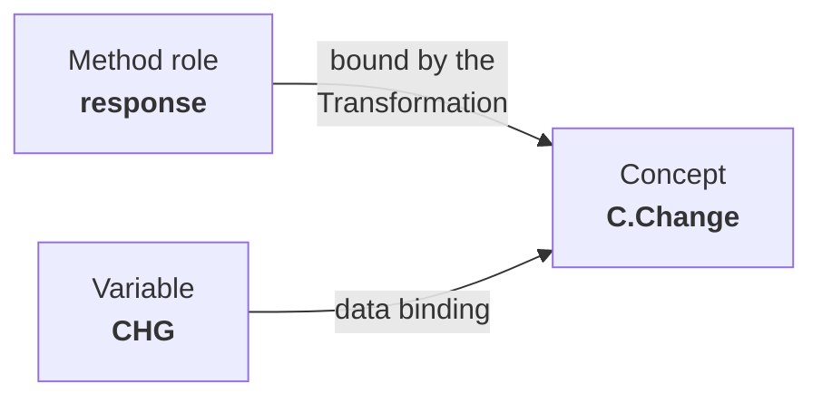
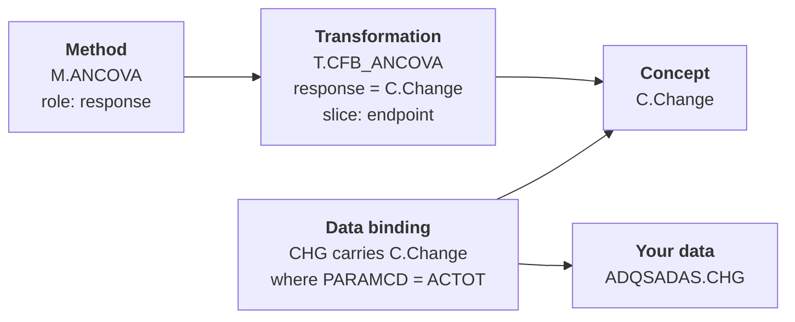

# 6. Data bindings

[Guide index](README.md) · Previous: [5. Transformations](05-transformations.md) · Next: [7. Your study](07-your-study.md)

**You will learn** how Concepts are tied to real variables, and why this is
kept apart from everything else.

## The idea

So far the model has said "change", "measure", "treatment" and never `CHG`,
`AVAL` or `TRTP`. A **data binding** makes the connection:

> *This variable carries this Concept, under these conditions.*

It is the only place in the model where a variable is named. Everything in
chapters 3 to 5 would work unchanged on a different data standard; only the
bindings would differ.



The arrow from the variable points *at* the Concept. A Concept never lists its
variables; variables declare what they carry.

## Class-level bindings: true for the whole standard

Some bindings hold wherever the standard is used. They are published in a
library, one file per standard. From `v1/lib/bindings/adam_bindings.json`:

```json
{
  "id": "ADaM.Change.CHG",
  "concept": "C.Change",
  "level": "classLevel",
  "locator": { "locatorType": "tabular", "datasetClass": "BasicDataStructure", "variable": "CHG" },
  "dataType": "decimal"
}
```

In words: *in any ADaM basic data structure, `CHG` carries a change*.

Some of the ADaM bindings:

| Concept | Variable | Dataset class | Note |
| --- | --- | --- | --- |
| `C.Subject` | `USUBJID` | Subject level | |
| `C.Parameter` | `PARAMCD` (code), `PARAM` (decode) | BDS | One Concept, two variables: the *facet* says which part |
| `C.AnalysisVisit` | `AVISIT`, `AVISITN` | BDS | |
| `C.Treatment` | `TRTP` / `TRTPN` (planned), `TRTA` / `TRTAN` (actual) | BDS | A *qualifier* says planned or actual |
| `C.Population` | `ITTFL`, `SAFFL`, `FASFL`, `PPROTFL` … | Subject level | A qualifier says which population |
| `C.Change` | `CHG` | BDS | |
| `C.Measure` | `AVAL`, `AVALC`; `BASE` for the baseline value | BDS | See below |

The SDTM bindings (`sdtm_bindings.json`) work the same way: `C.Result` is
carried by `--ORRES`, `--STRESC` and `--STRESN`; `C.Severity` by `--SEV`; and
so on. Each also records the CDISC data element concept code that the variable
carries in the SDTM Dataset Specialisations (more in chapter 11).

## The AVAL problem

Chapter 4 began with it: `AVAL` means different things for different
parameters. In the library, `AVAL` is bound to *five* Concepts:

| Variable | Concept |
| --- | --- |
| `AVAL` | `C.Measure` |
| `AVAL` | `C.PeakValue` |
| `AVAL` | `C.AreaUnderCurve` |
| `AVAL` | `C.EventCount` |
| `AVAL` | `C.TimeToEvent` |

A library cannot say which one applies, because that depends on the parameter,
and parameters belong to studies. So each of these bindings is marked:

```json
"parameterDependent": true
```

which means: *this is possible, but something more specific must decide*.

## Value-level bindings: true for one parameter

That "something more specific" is a **value-level binding**. It lives with the
study (or in a therapeutic-area package) and adds a condition:

```json
{
  "id": "CDISCPILOT01.PARAM.ADASCOG11.Measure",
  "concept": "C.Measure",
  "studyConcept": "PARAM.ADASCOG11",
  "level": "valueLevel",
  "locator": { "locatorType": "tabular", "dataset": "ADQSADAS", "variable": "AVAL" },
  "conditions": [ { "variable": "PARAMCD", "comparator": "EQ", "values": ["ACTOT"] } ]
}
```

In words: *in `ADQSADAS`, where `PARAMCD` equals `ACTOT`, `AVAL` carries a
measure*.

If this looks like define.xml value-level metadata, it should. A condition has
a variable, a comparator (`EQ`, `NE`, `IN`, `NOTIN`, `LT`, `LE`, `GT`, `GE`)
and values, exactly as a define.xml where clause does.

| | Class-level | Value-level |
| --- | --- | --- |
| Holds for | The standard | One parameter, in one study or package |
| Names | A dataset class and a variable | A dataset and a variable |
| Has conditions | No | Yes |
| Lives in | `v1/lib/bindings/` | The study file |
| define.xml counterpart | Variable-level metadata | Value-level metadata |

The baseline value has a binding of its own. In ADaM the baseline is carried on
every record as `BASE`, so:

```json
{
  "id": "CDISCPILOT01.PARAM.ADASCOG11.Baseline",
  "concept": "C.Measure",
  "locator": { "locatorType": "tabular", "dataset": "ADQSADAS", "variable": "BASE" },
  "conditions": [ { "variable": "PARAMCD", "comparator": "EQ", "values": ["ACTOT"] } ],
  "qualifiers": [ { "name": "reference", "value": "baseline" } ]
}
```

## Putting chapters 3 to 6 together

We can now follow one role of one Method all the way to a column.



The `resolve` tool does this walk for every input of an analysis:

```
python v1/tools/resolve.py cdiscpilot01 AC.PRIMARY.ADASCOG
```

```
  response      C.Change         <- ADQSADAS.CHG WHERE PARAMCD = 'ACTOT' AND AVISITN = 24 AND ITTFL = 'Y'
  covariate     C.Measure        <- ADQSADAS.BASE WHERE PARAMCD = 'ACTOT' AND AVISITN = 24 AND ITTFL = 'Y'   [baseline value carried on the analysis record]
  fixed_effect  C.Treatment      <- TRTP
```

Compare that with the program in chapter 2. `model CHG = BASE TRTP` and the
`where` statement are both there. The pieces came from four different places:

| Piece | Came from |
| --- | --- |
| `CHG`, `BASE` | Data bindings |
| `PARAMCD = 'ACTOT'` | The study's parameter (next chapter) |
| `AVISITN = 24` | The study's visit |
| `ITTFL = 'Y'` | The study's population |
| response, covariate, factor | The Transformation |

## Code is part of this layer too

The implementation layer has a second, smaller part: how a Method is run in a
language. `v1/lib/implementations/` holds call templates for SAS and R, with
the Method's roles as blanks:

```sas
proc glm data=<dataset>;
  class <fixed_effect>;
  model <response> = <covariate> <fixed_effect> / ss<ss_type> solution;
  lsmeans <fixed_effect> / pdiff cl alpha=<alpha> adjust=<multiplicity_adjustment>;
run;
```

and where each statistic is found in what the code returns (`S.estimate` of the
LS means is `LSMeans.LSMean`, and so on).

These catalogues are **informative**, not part of the standard: a standard that
fixed code would be tied to software versions. They cover 11 Methods in SAS and
19 in R, and need updating (chapter 14).

## Why keep bindings separate?

Because it is what makes the rest reusable.

| If you change … | You edit … | You do not touch … |
| --- | --- | --- |
| The dataset name in a study | One value-level binding | Methods, Concepts, Transformations |
| Your sponsor's ADaM conventions | Class-level bindings | Everything else |
| The data standard (SDTM, or a non-CDISC one later) | A new bindings library | Everything else |

## The rule for this layer

> Only data bindings name variables, and they point at Concepts.

Candidate v1 covers CDISC standards: 49 ADaM and 72 SDTM class-level bindings.
Other standards are left for later.

## Try it

In `v1/lib/bindings/adam_bindings.json`, find the bindings for
`C.Population`. How does a binding say that `SAFFL` is the *safety*
population? (With a qualifier: `{"name": "population", "value": "safety"}`.)

## What to take away

- A data binding says which variable carries which Concept.
- **Class-level** bindings hold for a standard and live in a library.
- **Value-level** bindings add a condition and live with the study, like
  define.xml value-level metadata.
- With bindings, a Method role can be followed all the way to a column.

You have now met four of the five layers. Before the fifth, it is time to see
how a study uses them.

Next: [7. Your study](07-your-study.md)
