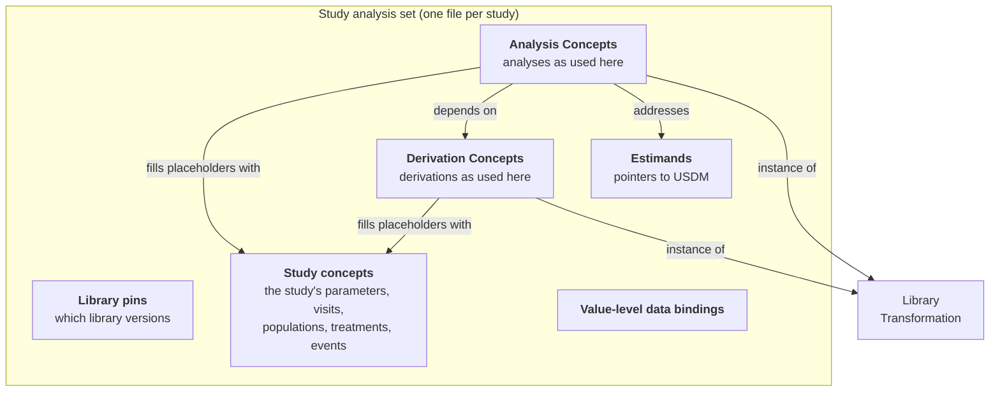
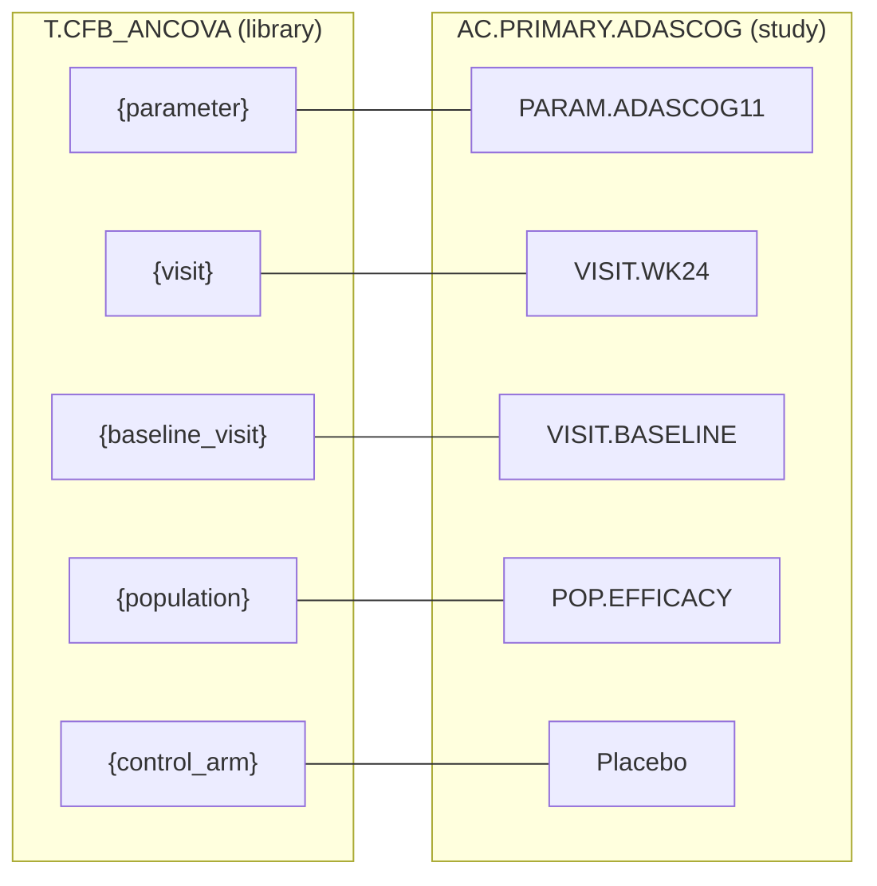
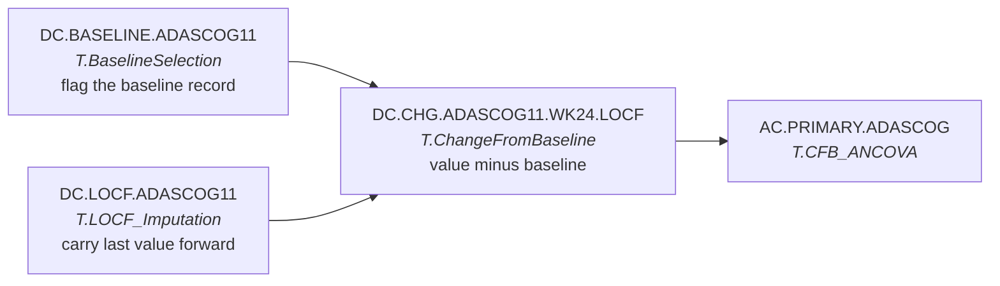

# 7. Your study

[Guide index](README.md) · Previous: [6. Data bindings](06-data-bindings.md) · Next: [8. SmartPhrases](08-smartphrases.md)

**You will learn** how a study uses the libraries, and what an "Analysis
Concept" actually is.

## The idea

The libraries say what *can* be done. A study says what *is* done: this
template, for this parameter, at this visit, in this population.

A study has one file, its **study analysis set**. For the running example it is
`v1/studies/cdiscpilot01/analysis_set.json`.



The rest of this chapter goes through the boxes in the order you would write
them.

## 1. Library pins

A study records exactly which version of each library it uses, so that a later
change to a library cannot silently change the study.

```json
"libraryPins": [
  { "library": "transformations", "version": "1.0.0-candidate" },
  { "library": "concepts",        "version": "1.0.0-candidate" },
  { "library": "methods",         "version": "1.0.0-candidate" }
]
```

The study does not copy the templates. It refers to them, at a pinned version.

## 2. Study concepts

The library has `C.Parameter`: "some parameter". The study has *its*
parameters. Each is a **study concept**: an instance of a library Concept, with
a name, a pointer to where it is defined, and how to find its records.

```json
{
  "id": "PARAM.ADASCOG11",
  "kind": "Parameter",
  "concept": "C.Parameter",
  "label": "ADAS-Cog(11)",
  "name": "Alzheimer's Disease Assessment Scale - Cognitive Subscale (11 items)",
  "reference": { "iri": "ncit:C168804", "iriStatus": "illustrative" },
  "dataSelection": {
    "dataset": "ADQSADAS",
    "conditions": [ { "variable": "PARAMCD", "comparator": "EQ", "values": ["ACTOT"] } ]
  }
}
```

| Field | Meaning |
| --- | --- |
| `kind`, `concept` | What sort of thing it is, and which library Concept it is an instance of |
| `label`, `name` | A short and a full form, both used when text is generated (chapter 8) |
| `reference` | Where it is really defined: a terminology, USDM, or a Biomedical Concept |
| `dataSelection` | How its records are found: here, `PARAMCD = 'ACTOT'` in `ADQSADAS` |

> `iriStatus: illustrative` means the identifier is a plausible stand-in, not a
> registered one. The example studies use many of these; chapter 14 explains.

The study concepts of the running example:

| Study concept | Kind | Found in the data by |
| --- | --- | --- |
| `PARAM.ADASCOG11` | Parameter | `PARAMCD = 'ACTOT'` in `ADQSADAS` |
| `PARAM.NPIX` | Parameter | `PARAMCD = 'NPTOT'` in `ADNPIX` |
| `VISIT.BASELINE`, `VISIT.WK8`, `VISIT.WK16`, `VISIT.WK24` | Timepoint | `AVISITN = 0`, `8`, `16`, `24` |
| `POP.EFFICACY`, `POP.PP`, `POP.SAFETY` | Population | `ITTFL = 'Y'`, `PPROTFL = 'Y'`, `SAFFL = 'Y'` |
| `TRT.ALL` | Treatment | the variable `TRTP` |
| `ICE.TRT_DISCONT`, `ICE.CONMED` | Intercurrent event | chapter 9 |

This list is the study's vocabulary. Every analysis is written using these
names and nothing else. Change `POP.EFFICACY` to use `EFFFL` here, once, and
every analysis that uses it follows.

## 3. An Analysis Concept

Now the central idea of the whole model.

> An **Analysis Concept** is one library Transformation, as used in one study.

It is not a new kind of library entry. It is a template plus the study's
choices. Here is the primary analysis, shortened:

```json
{
  "id": "AC.PRIMARY.ADASCOG",
  "label": "Primary efficacy analysis",
  "template": "T.CFB_ANCOVA",
  "placeholderValues": [
    { "name": "parameter",      "studyConcept": "PARAM.ADASCOG11" },
    { "name": "visit",          "studyConcept": "VISIT.WK24" },
    { "name": "population",     "studyConcept": "POP.EFFICACY" },
    { "name": "treatment",      "studyConcept": "TRT.ALL" },
    { "name": "baseline_visit", "studyConcept": "VISIT.BASELINE" },
    { "name": "control_arm",    "value": "Placebo" }
  ],
  "configurationValues": [
    { "name": "ss_type", "value": "III", "fixedByTemplate": true },
    { "name": "alpha",   "value": 0.05 }
  ],
  "dependsOn": [ "DC.CHG.ADASCOG11.WK24.LOCF" ],
  "…": "estimand, intercurrent events and SAP text: chapters 8 and 9"
}
```

Compare `placeholderValues` with the table of placeholders at the end of
chapter 5. The template left five things open. The study fills each one, with a
study concept or a value. That is the whole act of specifying an analysis.



### One template, several analyses

The study has four Analysis Concepts. All four use the same template.

| Analysis Concept | Parameter | Visit | Population |
| --- | --- | --- | --- |
| `AC.PRIMARY.ADASCOG` | ADAS-Cog (11) | Week 24 | Efficacy |
| `AC.SEC.NPIX` | NPI-X | Week 24 | Efficacy |
| `AC.SUPP.ADASCOG.WK16` | ADAS-Cog (11) | Week 16 | Efficacy |
| `AC.SENS.ADASCOG.TP` | ADAS-Cog (11) | Week 24 | Efficacy |

The first and the last look the same. They differ in how an intercurrent event
is handled, which is the subject of chapter 9.

## 4. Derivation Concepts

A **Derivation Concept** is the same thing for a derivation template.

```json
{
  "id": "DC.CHG.ADASCOG11.WK24.LOCF",
  "label": "Change from baseline in ADAS-Cog(11) at Week 24 (LOCF-imputed)",
  "template": "T.ChangeFromBaseline",
  "placeholderValues": [
    { "name": "parameter",      "studyConcept": "PARAM.ADASCOG11" },
    { "name": "visit",          "studyConcept": "VISIT.WK24" },
    { "name": "baseline_visit", "studyConcept": "VISIT.BASELINE" }
  ],
  "dependsOn": [ "DC.BASELINE.ADASCOG11", "DC.LOCF.ADASCOG11" ]
}
```

`dependsOn` records what must exist first. Follow it and you have the order in
which the analysis dataset must be built:



Read left to right, it is a build order for `ADQSADAS`. Read right to left, it
answers a reviewer's question: *where did this result come from?*

```
python v1/tools/resolve.py cdiscpilot01 AC.PRIMARY.ADASCOG
```

```
  derivations, in order: DC.BASELINE.ADASCOG11 -> DC.LOCF.ADASCOG11 -> DC.CHG.ADASCOG11.WK24.LOCF
```

## 5. From the study file to the where clause

You have now seen every piece that produced this line in chapter 6:

```
response  C.Change  <- ADQSADAS.CHG WHERE PARAMCD = 'ACTOT' AND AVISITN = 24 AND ITTFL = 'Y'
```

| Part of the line | Where it comes from |
| --- | --- |
| `response` | A role of `M.ANCOVA` (chapter 3) |
| `C.Change` | Bound to that role by `T.CFB_ANCOVA`, with the slice `endpoint` (chapter 5) |
| `ADQSADAS.CHG` | A data binding (chapter 6) |
| `PARAMCD = 'ACTOT'` | `{parameter}` → `PARAM.ADASCOG11` → its `dataSelection` |
| `AVISITN = 24` | `{visit}` → `VISIT.WK24` → its `dataSelection` |
| `ITTFL = 'Y'` | `{population}` → `POP.EFFICACY` → its `dataSelection` |

Nothing in that line was typed as a line. Each part was stated once, somewhere,
and assembled.

## What is checked

The validator (`python v1/tools/validate.py`) checks a study file against the
libraries. Among other things:

| Check | Rule |
| --- | --- |
| Every placeholder of the template has a value | Y3 |
| Each study concept is of the kind the placeholder needs | Y5 |
| An Analysis Concept uses an analysis template, a Derivation Concept a derivation template | Y2 |
| Every input of an analysis is either produced by a derivation it depends on, or bound to data | Y10 |
| The pinned library versions match the libraries | Y1 |

Chapter 13 shows these errors as you would meet them.

## Try it

Open `v1/studies/cdiscpilot01/analysis_set.json` and find `AC.SEC.NPIX`.
Which dataset will it read? Run
`python v1/tools/resolve.py cdiscpilot01 AC.SEC.NPIX` to check. Where did the
dataset name come from? (From the `dataSelection` of `PARAM.NPIX`.)

## What to take away

- A study has one file, which **pins** library versions and holds only the
  study's own choices.
- **Study concepts** are the study's parameters, visits, populations and
  treatments, each with the condition that finds its records.
- An **Analysis Concept** is a library Transformation plus values for its
  placeholders. A **Derivation Concept** is the same for a derivation.
- `dependsOn` gives the build order of the analysis datasets.

One thing in the SAP is still unaccounted for: the words.

Next: [8. SmartPhrases](08-smartphrases.md)
