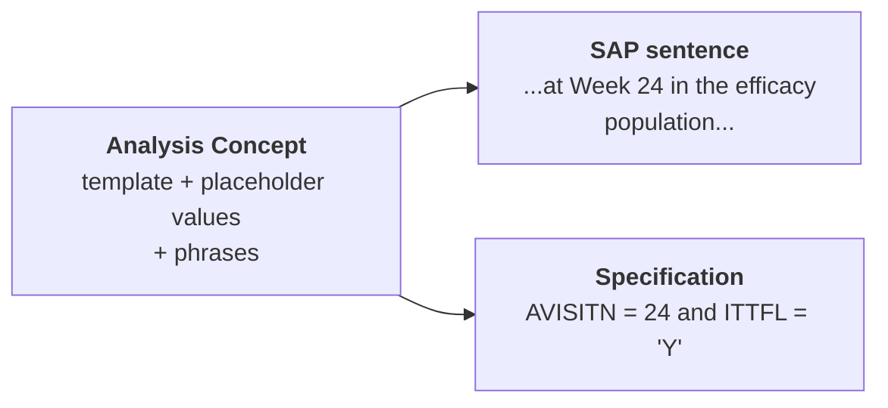

# 8. SmartPhrases

[Guide index](README.md) · Previous: [7. Your study](07-your-study.md) · Next: [9. Estimands](09-estimands.md)

**You will learn** how the SAP text is produced from the same description as
the analysis, so that the two cannot disagree.

## The idea

The Analysis Concept of chapter 7 says *ADAS-Cog (11), Week 24, efficacy
population, ANCOVA*. The SAP says the same in English. Today somebody types
both, and somebody else checks that they match.

A **SmartPhrase** is a small piece of SAP text with a blank in it. The blank is
filled from the model.

```
"change from baseline in {parameter}"   +   PARAM.ADASCOG11
        =   "change from baseline in ADAS-Cog(11)"
```

Join several and you have the sentence. This is the fifth layer of the model.

## A SmartPhrase

From `v1/lib/smartphrases/smartphrases.json`:

```json
{
  "conceptId": "SP_CFB_ENDPOINT",
  "name": "Change from baseline endpoint",
  "role": "endpoint",
  "phraseTemplate": "change from baseline in {parameter}",
  "anchors": { "producedConcept": "C.Change" },
  "placeholders": [
    { "name": "parameter", "kind": "concept_ref", "conceptConstraint": "Parameter",
      "renderOptions": ["label", "name", "name_with_label"],
      "defaultRender": "name_with_label", "required": true }
  ]
}
```

| Part | Meaning |
| --- | --- |
| `role` | The part this phrase plays in a sentence. Here: it names the endpoint |
| `phraseTemplate` | The text, with `{placeholders}` |
| `anchors` | What the phrase *means* in the model. Choosing this phrase means the analysis is about `C.Change` |
| `placeholders` | What may go in each blank. Here: a study concept that is a Parameter |

The `anchors` line is why these phrases are "smart". The phrase is not just
text; picking it is a statement about the analysis.

## The four kinds of blank

| Kind | Filled with | Example phrase | Example value |
| --- | --- | --- | --- |
| `concept_ref` | A study concept (chapter 7) | `at {visit}` | `VISIT.WK24` |
| `method_ref` | A Method (chapter 3) | `using {method}` | `M.ANCOVA` |
| `output_ref` | An output of the Method | `summarised as {summary}` | `SM.ANCOVA.ContrastsT` |
| `value` | A number or text, checked against a range | `with {conf_level}% confidence intervals` | `95` |

## Roles put phrases in order

Each phrase has one of ten roles. The roles have a fixed order, which is the
order of a typical analysis sentence.

| # | Role | Says | A phrase with this role |
| --- | --- | --- | --- |
| 1 | `endpoint` | What is analysed | `change from baseline in {parameter}` |
| 2 | `parameter` | Which measurement (when not in the endpoint phrase) | `for {parameter}` |
| 3 | `timepoint` | When | `at {visit}` |
| 4 | `population` | In whom | `in the {population} population` |
| 5 | `grouping` | Compared across | `comparing {treatment} groups` |
| 6 | `ice_handling` | How an intercurrent event is treated (chapter 9) | `as if {ice} had not occurred` |
| 7 | `method` | How | `using {method}` |
| 8 | `method_qualifier` | Details of how | `with {conf_level}% confidence intervals` |
| 9 | `covariate` | Adjusted for | `adjusting for baseline {parameter}` |
| 10 | `summary_measure` | Reported as | `summarised as {summary}` |

## The primary analysis, phrase by phrase

The Analysis Concept lists the phrases it uses and what fills each blank. This
is the part of `AC.PRIMARY.ADASCOG` that chapter 7 left out:

| Phrase used | Blank | Filled with | Becomes |
| --- | --- | --- | --- |
| `SP_CFB_ENDPOINT` | `{parameter}` | `PARAM.ADASCOG11` (name and label) | change from baseline in Alzheimer's Disease Assessment Scale - Cognitive Subscale (11 items) (ADAS-Cog(11)) |
| `SP_TIMEPOINT` | `{visit}` | `VISIT.WK24` (label) | at Week 24 |
| `SP_POPULATION` | `{population}` | `POP.EFFICACY` (name) | in the efficacy (intent-to-treat) population |
| `SP_GROUPING` | `{treatment}` | `TRT.ALL` (label) | comparing treatment groups |
| `SP_ICE_HYPOTHETICAL` | `{ice}` | `ICE.TRT_DISCONT` | as if discontinuation of study treatment had not occurred |
| `SP_ICE_TREATMENT_POLICY` | `{ice}` | `ICE.CONMED` | regardless of use of concomitant AD medication |
| `SP_METHOD_ANCOVA` | `{method}` | `M.ANCOVA` (label) | using ANCOVA |
| `SP_CONFIDENCE_LEVEL` | `{conf_level}` | `95` | with 95% confidence intervals |
| `SP_COVARIATE_BASELINE` | `{parameter}` | `PARAM.ADASCOG11` (label) | adjusting for baseline ADAS-Cog(11) |
| `SP_SUMMARY_MEASURE` | `{summary}` | `SM.ANCOVA.ContrastsT` | summarised as the difference in least-squares means |

In the file, one row of that table looks like this:

```json
{ "phrase": "SP_TIMEPOINT",
  "bindings": [ { "slot": "visit", "studyConcept": "VISIT.WK24", "render": "label" } ] }
```

`render` chooses between the study concept's short `label` ("Week 24"), its
full `name` ("Week 24 (end of double-blind treatment period)") or both.

## From phrases to a sentence

A **sentence template** says where each role goes and what punctuation
surrounds it. The English one is:

```
{endpoint} {parameter} {timepoint} {population} {grouping}[, {ice_handling},]
{method} {method_qualifier} {covariate}[, {summary_measure},]
will be assessed as {sentenceRole}.
```

Square brackets mark a group that is dropped, commas and all, when none of its
roles is filled. `{sentenceRole}` is the analysis's own description of itself,
"the primary analysis".

```
python v1/tools/render.py cdiscpilot01
```

> Change from baseline in Alzheimer's Disease Assessment Scale - Cognitive
> Subscale (11 items) (ADAS-Cog(11)) at Week 24 in the efficacy
> (intent-to-treat) population comparing treatment groups, as if
> discontinuation of study treatment had not occurred and regardless of use of
> concomitant AD medication, using ANCOVA with 95% confidence intervals
> adjusting for baseline ADAS-Cog(11), summarised as the difference in
> least-squares means, will be assessed as the primary analysis.

The same Analysis Concept, with fewer phrases, gives a shorter sentence. The
secondary analysis uses six of them:

> Change from baseline in Neuropsychiatric Inventory - Revised, mean domain
> total score (NPI-X) at Week 24 in the efficacy (intent-to-treat) population
> comparing treatment groups using ANCOVA adjusting for baseline NPI-X will be
> assessed as a secondary analysis.

## One description, two outputs

This is the point of the layer.



"Week 24" in the sentence and `AVISITN = 24` in the where clause both come from
the one study concept `VISIT.WK24`. Change the visit to Week 16 and both
change. They cannot drift apart, because there is only one of them.

> **Text is generated, never parsed.** The model does not read a SAP and work
> out what it means. You choose phrases and fill blanks, and the text is the
> result. Free prose in a SAP (rationale, background) stays as prose; it is not
> part of this model.

## Other languages

Because the model stores identifiers and not words, the same analysis can be
written in another language. A **language pack** supplies the sentence
template (which owns the word order), translated phrases, and names.

```
python v1/tools/render.py cdiscpilot01 fr
```

> La variation de l'échelle d'évaluation de la maladie d'Alzheimer –
> sous-échelle cognitive (11 items) (ADAS-Cog(11)) par rapport à la valeur
> initiale à la semaine 24 dans la population d'efficacité (intention de
> traiter) …

The library has English, French and German packs. The French and German ones
are illustrative and have not been checked by a translator.

## Which phrases an analysis may use

A Transformation lists the phrases it accepts, as `validSmartPhrases`.
`T.CFB_ANCOVA` accepts the change-from-baseline endpoint phrase and the ANCOVA
method phrase. It does not accept "using Kaplan-Meier estimation". So an
analysis cannot be described with words that do not fit it; the validator
reports it (rule Y5).

## The rule for this layer

> A SmartPhrase is bound to Concepts, Methods, outputs and values. It never
> names a variable.

## Try it

Run `python v1/tools/render.py cdiscpilot01 de`. Then look at the German
sentence template in `smartphrases.json` (`languagePacks`, `"language": "de"`).
Where does the verb go, and why could English word order not simply be reused?

## What to take away

- A SmartPhrase is SAP text with typed blanks, playing one **role**.
- An Analysis Concept lists its phrases and what fills each blank.
- The sentence and the specification are generated from the same study
  concepts, so they agree by construction.
- Text is generated from the model. The model never parses text.

Two phrases in the table above were about "intercurrent events". They need a
chapter of their own.

Next: [9. Estimands](09-estimands.md)
