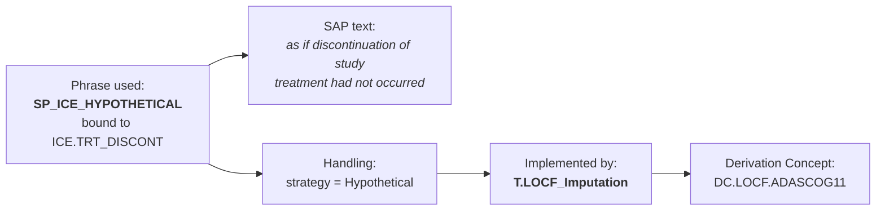
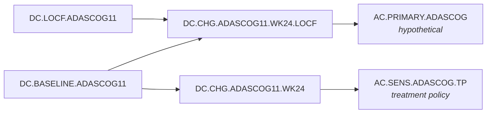

# 9. Estimands

[Guide index](README.md) · Previous: [8. SmartPhrases](08-smartphrases.md) · Next: [10. A second study](10-a-second-study.md)

**You will learn** how an analysis is tied to the estimand it addresses, and
how the handling of intercurrent events becomes something a program can check
and act on.

## A two-minute refresher

ICH E9(R1) asks that a trial state precisely *what* is being estimated before
saying how. That statement is the **estimand**. It has five attributes.

An **intercurrent event** is something that happens after treatment starts and
changes what the measurements mean, or whether they exist: stopping treatment,
taking rescue medication, dying. For each, the estimand says which **strategy**
applies.

| Strategy | In plain words | What it means for the data |
| --- | --- | --- |
| Treatment policy | "Regardless of the event" | Use the values as observed |
| Hypothetical | "As if the event had not happened" | Values after the event are replaced by a model or imputation |
| Composite | "The event is itself an outcome" | The event is built into the variable (for example, counted as failure) |
| While on treatment | "Up to the event" | Use values before the event only |
| Principal stratum | "In those who would not have the event" | Restrict the population |

For a programmer the right-hand column is the one that matters. A strategy is
not a comment in the SAP. It decides which records are analysed and how they
are derived.

## Who owns what

The estimand belongs to the protocol, and in CDISC terms to **USDM**. Analysis
Concepts does not redefine it. The study file holds a pointer to each
estimand, and the list of intercurrent events in its scope:

```json
{
  "id": "EST.PRIMARY",
  "reference": { "iri": "usdm:Estimand/CDISCPILOT01-EST-PRIMARY", "iriStatus": "illustrative" },
  "label": "Primary estimand — ADAS-Cog(11) change at Week 24",
  "rank": "primary",
  "intercurrentEvents": [ "ICE.TRT_DISCONT", "ICE.CONMED" ]
}
```

The intercurrent events are study concepts, like parameters and visits
(chapter 7):

| Study concept | Meaning |
| --- | --- |
| `ICE.TRT_DISCONT` | Discontinuation of study treatment |
| `ICE.CONMED` | Use of concomitant Alzheimer's medication |

> The published CDISC Pilot has no list of intercurrent events. These two were
> constructed for the example.

## The five attributes, and where each is recorded

You have already met four of them without the name.

| Estimand attribute | In the Analysis Concept | SmartPhrase role |
| --- | --- | --- |
| Treatment | `{treatment}` → `TRT.ALL` | `grouping` |
| Population | `{population}` → `POP.EFFICACY` | `population` |
| Variable (endpoint) | `{parameter}`, `{visit}` and the template's response | `endpoint`, `parameter`, `timepoint` |
| Intercurrent events and their strategies | `iceHandlings` | `ice_handling` |
| Population-level summary | `summaryOutput` → `SM.ANCOVA.ContrastsT` | `summary_measure` |

> A caution. `POP.EFFICACY` is an *analysis set*. The estimand's population is
> the *target population* of patients. They are related but not the same, and
> candidate v1 does not yet separate them.

## How an analysis states its handling

Each Analysis Concept says which estimand it addresses, what part it plays, and
how it handles **every** intercurrent event in that estimand's scope.

```json
"addressesEstimand": "EST.PRIMARY",
"analysisRole": "MainEstimator",
"iceHandlings": [
  { "intercurrentEvent": "ICE.TRT_DISCONT",
    "strategy": "Hypothetical",
    "basis": "statedByPhrase", "fromPhrase": "SP_ICE_HYPOTHETICAL",
    "implementedBy": [ "T.LOCF_Imputation" ] },
  { "intercurrentEvent": "ICE.CONMED",
    "strategy": "TreatmentPolicy",
    "basis": "statedByPhrase", "fromPhrase": "SP_ICE_TREATMENT_POLICY",
    "implementedBy": [] }
]
```

| Field | Meaning |
| --- | --- |
| `strategy` | One of the five |
| `basis` | Why: the analysis says so in a phrase, or the study's default applies |
| `implementedBy` | The library Transformations that carry the strategy out. Empty for treatment policy, because nothing needs doing |

`implementedBy` is the important one. "As if discontinuation had not occurred"
is tied to an actual derivation, `T.LOCF_Imputation`. The words in the SAP and
the step in the dataset build are the same statement.

> **A doubt, stated plainly.** Last observation carried forward is the only
> imputation derivation the library has, so the example uses it. Whether it is
> an acceptable way to implement a hypothetical strategy is a statistical
> question that the working group has not settled.

## The words and the handling come from one place

The phrase and the handling are two views of one choice.



## A sensitivity analysis is a different estimand

The study has a second analysis of the same endpoint, visit and population. It
handles treatment discontinuation by **treatment policy** instead.

Changing the strategy changes the question being asked. So it is not the same
estimand analysed differently; it is a different estimand, `EST.SENS.TP`.

| | `AC.PRIMARY.ADASCOG` | `AC.SENS.ADASCOG.TP` |
| --- | --- | --- |
| Template | `T.CFB_ANCOVA` | `T.CFB_ANCOVA` |
| Parameter, visit, population | ADAS-Cog (11), Week 24, efficacy | the same |
| Estimand addressed | `EST.PRIMARY` | `EST.SENS.TP` |
| Discontinuation handled as | Hypothetical | Treatment policy |
| SAP wording | *as if discontinuation of study treatment had not occurred* | *regardless of discontinuation of study treatment* |
| Reads | LOCF-imputed change | Change as observed |

The last row is the consequence a programmer cares about. The two analyses
depend on different derivations:



```
python v1/tools/resolve.py cdiscpilot01 AC.PRIMARY.ADASCOG AC.SENS.ADASCOG.TP
```

```
AC.PRIMARY.ADASCOG
  derivations, in order: DC.BASELINE.ADASCOG11 -> DC.LOCF.ADASCOG11 -> DC.CHG.ADASCOG11.WK24.LOCF
AC.SENS.ADASCOG.TP
  derivations, in order: DC.BASELINE.ADASCOG11 -> DC.CHG.ADASCOG11.WK24
```

In ADaM practice this is the difference between analysing records that include
`DTYPE = 'LOCF'` rows and analysing observed records only. Here it is not a
convention to remember; it follows from the strategy.

## When an analysis says nothing

`AC.SUPP.ADASCOG.WK16` repeats the primary analysis at Week 16. Its sentence
does not mention intercurrent events. That does not mean it ignores them. The
study's default strategy for each event applies, and the Analysis Concept says
so explicitly:

```json
{ "intercurrentEvent": "ICE.TRT_DISCONT", "strategy": "Hypothetical",
  "basis": "studyDefault", "implementedBy": [ "T.LOCF_Imputation" ] }
```

Silence in the SAP is recorded as a decision, with its reason.

## Analysis roles

| `analysisRole` | Meaning |
| --- | --- |
| `MainEstimator` | The analysis that estimates the estimand |
| `SensitivityAnalysis` | The same estimand, under different assumptions |
| `SupplementaryAnalysis` | Further understanding of the same estimand |

## What is checked

| Rule | Check |
| --- | --- |
| Y7 | Every estimand has exactly one main estimator |
| Y8 | An analysis states a handling for every intercurrent event in its estimand's scope, and for no other |
| Y8 | A strategy other than treatment policy names a Transformation that implements it |
| Y8 | A handling that a phrase states uses the strategy that phrase asserts |

So a SAP that says "hypothetical" for an event, with nothing in the datasets to
carry it out, is an error and not a finding at audit.

## What is not there yet

- Only **treatment policy** and **hypothetical** are worked through. The other
  three strategies have phrases but no implementing Transformation.
- **How an intercurrent event is detected** in the data (which disposition
  record, which medication category) is deliberately outside Analysis
  Concepts. It belongs to an electronic SAP model. Each example study has a
  small file, `esap-extension.example.json`, showing what that would hold.
- **Multiplicity and hypotheses** are also left to an electronic SAP model.

## Try it

`AC.SEC.NPIX` addresses `EST.SECONDARY.NPIX`. How many intercurrent events
are in that estimand's scope? What does its `iceHandlings` therefore contain?
(None, and so nothing. An empty scope is a valid, explicit answer.)

## What to take away

- The estimand lives in USDM. An Analysis Concept points at it with
  `addressesEstimand` and states its `analysisRole`.
- Every intercurrent event in scope gets a **handling**: a strategy, and the
  Transformations that implement it.
- The SAP wording and the handling come from the same phrase.
- A different strategy is a different estimand, and leads to a different
  derivation chain.

You have now seen every part of the model on one example. The next chapter
checks your understanding against a different kind of analysis.

Next: [10. A second study](10-a-second-study.md)
