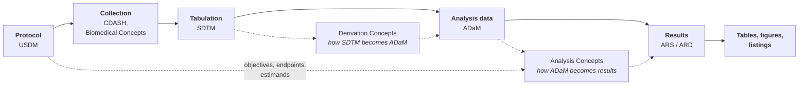

# 11. Other CDISC standards

[Guide index](README.md) · Previous: [10. A second study](10-a-second-study.md) · Next: [12. Automation](12-automation.md)

**You will learn** where Analysis Concepts sits among the standards you already
use, what it takes from each, and what it does not replace.

## The picture

The existing standards describe the *data at each stage*. Analysis Concepts
describes the *steps between the stages*: the derivations that turn tabulated
data into analysis data, and the analyses that turn analysis data into
results. It also carries the thread from the protocol's estimand to the
analysis that addresses it.

## Standard by standard

### USDM (the digital protocol)

| USDM has | Analysis Concepts |
| --- | --- |
| Objectives, endpoints | An Analysis Concept points at the objective it serves (`addressesObjective`) |
| Estimands and their intercurrent events | An Analysis Concept points at its estimand (`addressesEstimand`) and states a handling for each event (chapter 9) |
| Arms, visits (encounters), analysis populations | Study concepts point at them (`reference`) |

The rule is one-way: Analysis Concepts refers to USDM and never changes it. The
protocol is written first and stays the single source for what it defines.

### Biomedical Concepts and Dataset Specialisations

A **Biomedical Concept** is one specific clinical measurement: systolic blood
pressure, ADAS-Cog (11) total score. Its **Dataset Specialisation** says how it
is represented in SDTM: which variables, which fixed values, which codelists.

Two links.

**Parameters come from Biomedical Concepts.** A template says "some
parameter". A study's parameter is, in the end, a Biomedical Concept. (In the
template, the parameter's slice key has the source `biomedicalConcept`.)

**Data bindings copy the pattern.** A Dataset Specialisation and a data binding
do the same job at different stages:

| | Dataset Specialisation | Data binding (chapter 6) |
| --- | --- | --- |
| Abstract thing | A Biomedical Concept | A Concept |
| Tied to | SDTM variables | ADaM or SDTM variables |
| Fixed values and conditions | Yes | Yes, as conditions |
| Published by | CDISC Library | Class-level: a library. Value-level: the study |

The SDTM bindings in this repository record, for each variable, the data
element concept code it carries in the specialisations, so the specialisations
remain the reference.

How do a Biomedical Concept and a `collected` Concept differ? A collected
Concept is the *general shape* of a recording (a topic, a time, a result with
a unit). A Biomedical Concept is one *specific* recording that fits that shape.
A standard derivation has to work for any numeric result, so it refers to the
general shape. The specific one arrives when a study fills in `{parameter}`.

### SDTM

SDTM is a source. `collected` Concepts are what SDTM variables carry, and SDTM
bindings say which. Derivation Transformations start from them.

### ADaM

ADaM is where most of a programmer's contact with the model is.

| ADaM idea | In Analysis Concepts |
| --- | --- |
| A BDS dataset: one record per subject, parameter and visit | A data structure whose dimensions are `C.Subject`, a parameter and a visit |
| `PARAMCD`, `AVISIT`, population flags | Dimensions; fixed by slices; found through study concepts |
| `AVAL`, `BASE`, `CHG` | Measures, through data bindings |
| A derived variable and its derivation | A Derivation Concept |
| `DTYPE = 'LOCF'` records | A derivation that implements an intercurrent-event strategy (chapter 9) |
| Analysis-ready: "one proc away" | An Analysis Concept whose inputs are all bound to variables |

Analysis Concepts does not replace ADaM. It says *why* each variable is needed
and *how* it is derived, which is what an ADaM specification records.

### define.xml

define.xml describes datasets as they were built. Much of what it records is a
view of what Analysis Concepts holds.

| define.xml | Analysis Concepts | Chapter |
| --- | --- | --- |
| `ItemGroupDef` (a dataset) | The dataset named in a study concept's data selection | 7 |
| `ItemDef` (a variable) | A data binding's variable | 6 |
| `ValueListDef` with `WhereClauseDef` (value-level metadata) | A value-level binding with conditions | 6 |
| `RangeCheck` comparator (`EQ`, `IN` …) | The same comparators | 6 |
| `MethodDef` (a derivation, as text) | A Derivation Concept (as structure: template, method, inputs) | 7 |
| Analysis results metadata: display, reason, purpose | An Analysis Concept: its label, role and sentence | 7 to 9 |
| Analysis results metadata: dataset, where clause, analysis variable | Resolved from the Analysis Concept | 6, 7 |
| Analysis results metadata: documentation | The generated sentence | 8 |
| Analysis results metadata: programming code | A call template filled in | 12 |

The difference is direction. define.xml is written *after* the datasets, to
describe them. Analysis Concepts is written *before*, and the define.xml
content can be produced from it (chapter 12).

### ARS and ARD

The Analysis Results Standard describes analyses and their results: a
reporting event containing analyses, each with a method made of operations,
applied to an analysis set, a data subset and groupings; and outputs and
displays.

| ARS | Analysis Concepts |
| --- | --- |
| Analysis | An Analysis Concept (it points at its ARS analysis with `arsAnalysis`) |
| Analysis method and its operations | A Method, its sub-methods and their statistics |
| Analysis set | The population slice |
| Data subset | The parameter and visit slices |
| Grouping factor | A dimension bound to a categorical role (treatment) |
| Operation results | Values of the statistics, in the output data structure |
| Reporting event, outputs, displays | Not in Analysis Concepts (see below) |

ARS says *what was analysed and what came out*. Analysis Concepts adds *what
the method is* (its model, terms and configurations), *what it needs* (the
derivations) and *why* (the estimand). The two are meant to be used together.

> The correspondence above is conceptual. A field-by-field mapping between an
> Analysis Concept and an ARS analysis has not been written yet.

### Table shells

A shell is a choice of statistics, arranged. The statistics come from the
outputs of the Method (chapter 3):

| Shell row (chapter 2) | Output | Statistics |
| --- | --- | --- |
| LS mean (SE) | `SM.ANCOVA.LsMeans` | `S.estimate`, `S.SE` |
| 95% CI | `SM.ANCOVA.LsMeans` | `S.CI_lower`, `S.CI_upper` |
| LS mean difference (SE) | `SM.ANCOVA.ContrastsT` | `S.estimate`, `S.SE` |
| 95% CI of the difference | `SM.ANCOVA.ContrastsT` | `S.CI_lower`, `S.CI_upper` |
| p-value | `SM.ANCOVA.ContrastsT` | `S.p_value` |

Columns come from the levels of the grouping dimension (the treatment arms),
and the title from the parameter, visit and population. Layout, formatting and
decimal places are not part of Analysis Concepts.

## What Analysis Concepts does not do

| It does not … | That belongs to … |
| --- | --- |
| Define the study design, estimands or populations | USDM |
| Define what a clinical measurement is | Biomedical Concepts |
| Define dataset structures or variable naming | SDTM, ADaM |
| Hold the results | ARS / ARD |
| Lay out or format tables | Display standards and your tools |
| Hold the SAP as a document: sections, free text, reporting events, multiplicity | An electronic SAP model, which builds on Analysis Concepts |
| Choose the analysis | The statistician |

The last line matters. Analysis Concepts standardises *how a choice is
written down*, not *which choice is right*. It will record an ANCOVA exactly.
It will not tell you to use one.

## One row through every standard

The running example, end to end:

| Stage | Standard | The same analysis there |
| --- | --- | --- |
| Question | USDM | Objective, endpoint and estimand `EST.PRIMARY` |
| Measurement | Biomedical Concept | ADAS-Cog (11) total score |
| Collected | SDTM | `QS` records for the ADAS-Cog items |
| Derived | Derivation Concepts | Baseline flag → LOCF → change from baseline |
| Analysis data | ADaM | `ADQSADAS`: `AVAL`, `BASE`, `CHG` where `PARAMCD = 'ACTOT'` |
| Analysis | Analysis Concept | `AC.PRIMARY.ADASCOG`, an instance of `T.CFB_ANCOVA` |
| Result | ARS / ARD | LS means and differences, by treatment |
| Display | Table | Table 14.2.1 |
| Text | SAP | The generated sentence |

## What to take away

- The data standards describe each stage. Analysis Concepts describes the steps
  between them, and the link back to the estimand.
- It refers to USDM and Biomedical Concepts; it binds to SDTM and ADaM; it
  feeds ARS, define.xml and shells.
- Much of define.xml's analysis results metadata is a view of an Analysis
  Concept.
- It does not replace any of them, and it does not choose the analysis.

Next: [12. Automation](12-automation.md)
