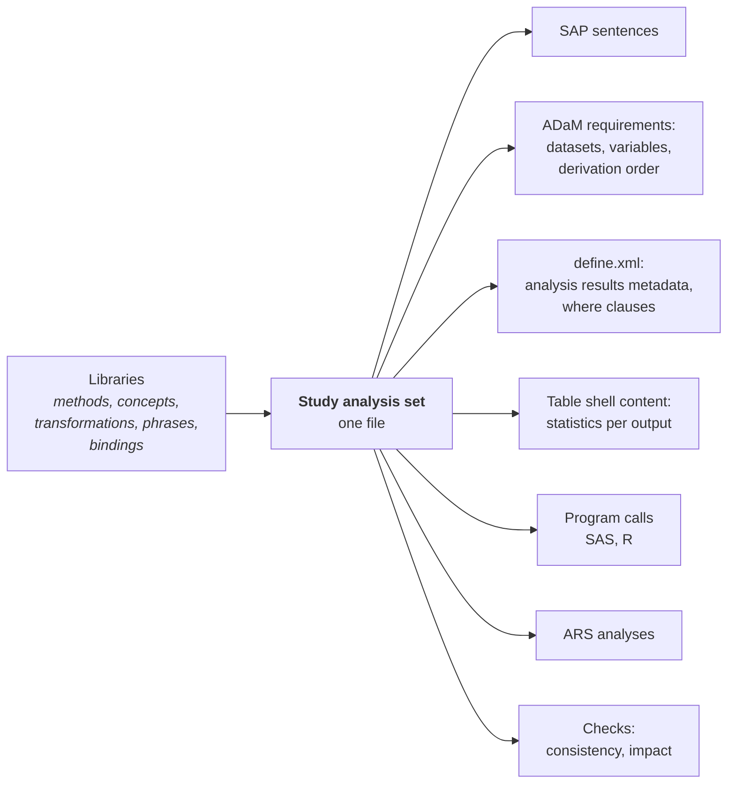

# 12. Automation

[Guide index](README.md) · Previous: [11. Other CDISC standards](11-other-standards.md) · Next: [13. Describing your own analysis](13-describing-your-own-analysis.md)

**You will learn** what can be produced from a study analysis set, shown with
real output from the tools in this repository, and what cannot be produced yet.

## The idea

Chapter 2 showed one analysis written down in five artefacts. With the study
described once, each artefact becomes something to *generate* or to *check*.



Every example in this chapter is the output of a command you can run. The
tools are small reference implementations, there to show that the information
is in the model. They are not production software.

## 1. SAP text

```
python v1/tools/render.py cdiscpilot01
```

> Change from baseline in Alzheimer's Disease Assessment Scale - Cognitive
> Subscale (11 items) (ADAS-Cog(11)) at Week 24 in the efficacy
> (intent-to-treat) population comparing treatment groups, as if
> discontinuation of study treatment had not occurred and regardless of use of
> concomitant AD medication, using ANCOVA with 95% confidence intervals
> adjusting for baseline ADAS-Cog(11), summarised as the difference in
> least-squares means, will be assessed as the primary analysis.

**What you get:** one sentence per analysis, in each language that has a
language pack. **What you do not get:** the rest of the SAP. Rationale, sample
size and background are prose, and stay prose.

## 2. ADaM requirements

Which datasets and variables do the planned analyses need, and what has to be
derived to provide them? This is the question an ADaM specification starts
from, usually answered by reading the SAP.

```
python v1/tools/downstream.py cdiscpilot01 adam
```

| Dataset | Variable | Carries | Used as | Needed by | Produced by |
| --- | --- | --- | --- | --- | --- |
| ADQSADAS | PARAMCD | | record selection | AC.PRIMARY.ADASCOG, AC.SUPP.ADASCOG.WK16, AC.SENS.ADASCOG.TP | |
| ADQSADAS | AVISITN | | record selection | (the same three) | |
| ADQSADAS | ITTFL | | record selection | (the same three) | |
| ADQSADAS | TRTP | C.Treatment | analysis input (fixed_effect) | (the same three) | |
| ADQSADAS | BASE | C.Measure | analysis input (covariate) | (the same three) | |
| ADQSADAS | CHG | C.Change | analysis input (response) | (the same three) | DC.CHG.ADASCOG11.WK24.LOCF, DC.CHG.ADASCOG11.WK16.LOCF, DC.CHG.ADASCOG11.WK24 (all T.ChangeFromBaseline) |
| ADQSADAS | (study to assign) | C.Flag, C.Measure | | | DC.BASELINE.ADASCOG11 (T.BaselineSelection); DC.LOCF.ADASCOG11 (T.LOCF_Imputation) |

(The table is abbreviated: repeated cell contents are shortened, and the command also lists `ADNPIX`.)

Read it as the skeleton of a specification:

- **Rows with "Needed by"** are variables an analysis reads. Each says why it
  is there.
- **Rows with "Produced by"** are variables a derivation creates. Each names
  the standard derivation that defines it.
- **"(study to assign)"** means the model knows a value is produced (a baseline
  flag, an imputed value) but no binding says which variable holds it. That is
  a decision for the study, and the tool says so instead of guessing.

The derivation order completes the picture:

```
python v1/tools/resolve.py cdiscpilot01 AC.PRIMARY.ADASCOG
```

```
  derivations, in order: DC.BASELINE.ADASCOG11 -> DC.LOCF.ADASCOG11 -> DC.CHG.ADASCOG11.WK24.LOCF
```

**What you get:** the variables each analysis needs, the reason for each, and
the order of derivations. **What you do not get:** a complete ADaM
specification. Labels, lengths, codelists, sort keys and the variables kept
for traceability are not in the model.

## 3. define.xml analysis results metadata

```
python v1/tools/downstream.py cdiscpilot01 arm AC.PRIMARY.ADASCOG
```

| Item | Value |
| --- | --- |
| Analysis reason | SPECIFIED IN SAP (main estimator) |
| Analysis purpose | the primary analysis |
| Analysis dataset | ADQSADAS |
| Where clause | PARAMCD = 'ACTOT' AND AVISITN = 24 AND ITTFL = 'Y' |
| Analysis variable(s) | CHG, BASE |
| Method | M.ANCOVA via T.CFB_ANCOVA |
| Summary output | T-based contrasts |
| Documentation | Change from baseline in Alzheimer's Disease Assessment Scale - Cognitive Subscale (11 items) (ADAS-Cog(11)) at Week 24 … will be assessed as the primary analysis. |

Compare it with the analysis results metadata table in chapter 2. Each item is
there, and none was typed for this purpose:

| Item | Assembled from |
| --- | --- |
| Reason, purpose | `analysisRole`, `sentenceRole` |
| Dataset | The parameter's data selection |
| Where clause | The conditions of the parameter, visit and population |
| Analysis variables | The data bindings of the template's measures |
| Documentation | The generated sentence |
| Programming code | The next section |

The same holds for a time-to-event analysis
(`python v1/tools/downstream.py pre0102 arm AC.PRIMARY.PFS`): dataset `ADTTE`,
where clause `PARAMCD = 'PFS' AND EFFIFL = 'Y'`, variables `AVAL, CNSR`.

**What you get:** the content of analysis results metadata, as a table.
**What you do not get:** define.xml itself. Writing the XML, and the display
identifiers, is left to a real tool.

## 4. Program calls

The same command prints the call for each language that has an implementation
of the Method:

```sas
proc glm data=ADQSADAS;
  where PARAMCD = 'ACTOT' and AVISITN = 24 and ITTFL = 'Y';
  class TRTP;
  model CHG = BASE TRTP / ss3 solution;
  lsmeans TRTP / pdiff cl alpha=0.05 adjust=<multiplicity_adjustment>;
run;
quit;
```

```r
model <- lm(CHG ~ BASE + TRTP, data = subset(ADQSADAS, PARAMCD == "ACTOT" & AVISITN == 24 & ITTFL == "Y"))
model_summary <- summary(model)
anova_result <- car::Anova(model, type = "III")
lsm <- emmeans::emmeans(model, ~ TRTP)
lsm_df <- as.data.frame(summary(lsm, infer = TRUE, level = 1 - 0.05))
contr <- pairs(lsm, adjust = "<multiplicity_adjustment>")
contr_df <- as.data.frame(summary(contr, infer = TRUE, level = 1 - 0.05))
```

Set this beside the hand-written program in chapter 2. It is the same call.
Where each part came from:

| In the code | From |
| --- | --- |
| `proc glm … class … model … lsmeans` | The SAS call template for `M.ANCOVA` |
| `CHG`, `BASE`, `TRTP` | Roles → Concepts → data bindings |
| `where …` | Study concepts |
| `ss3` | `ss_type = III`, fixed by the template, translated by the SAS catalogue |
| `alpha=0.05` | `alpha`, set by the study |
| `<multiplicity_adjustment>` | **Not filled.** The call template asks for something the Method does not have |

That last line is deliberate. The tool leaves what it cannot fill in angle
brackets and reports it:

```
Not filled by the model: <multiplicity_adjustment>
```

> **These are not validated programs.** The call templates come from
> informative catalogues that predate the current method definitions and need
> revising. The point is that a single specification can produce the same
> analysis in two languages, with the same variables and conditions. A
> generated program would still need the same review as a written one.

**What you get:** a call with variables, conditions and options filled in, for
the 11 Methods with a SAS template and the 19 with an R template.
**What you do not get:** a call for Kaplan-Meier, MMRM or most other
model-based Methods (no template yet), or a complete program.

## 5. Table shell content

```
python v1/tools/downstream.py cdiscpilot01 shell AC.PRIMARY.ADASCOG
```

| Output | Concept | Statistics |
| --- | --- | --- |
| Least-squares means | C.LSMeans | estimate, CI_lower, CI_upper, SE, df |
| T-based contrasts **(summary measure)** | C.Contrasts | estimate, CI_lower, CI_upper, SE, df, t_statistic, p_value, p_value_adjusted (optional) |
| Type III F-tests | C.Type3Tests | F_statistic, p_value, df_num, df_den, SS, MS |
| Linear-model parameter estimates | C.ParameterEstimates | estimate, CI_lower, CI_upper, SE, df, t_statistic, p_value, coefficient |
| Linear-model fit statistics | C.FitStatistics | AIC, BIC, minus2LogL, R_squared |

This is everything the analysis can put in a table. The shell in chapter 2
uses the first two rows. The one marked "summary measure" is what the SAP
sentence says the analysis is "summarised as": it is the headline result.

And for the Kaplan-Meier analysis:

| Output | Concept | Statistics |
| --- | --- | --- |
| Median survival **(summary measure)** | C.MedianSurvival | estimate, CI_lower, CI_upper |
| Survival table | C.SurvivalTable | estimate, CI_lower, CI_upper, SE, n_risk, n_event, n_censored |
| Event summary | C.EventSummary | n_risk, n_event, n_censored |
| Landmark estimates | C.LandmarkEstimates | estimate, CI_lower, CI_upper, SE |

**What you get:** the statistics available for the body of the table, by
output, and which one is the headline. **What you do not get:** the layout.
Which rows, in what order, with how many decimals, is not in the model.

## 6. ARS

An Analysis Concept holds what an ARS analysis needs: the method and its
operations (sub-methods and statistics), the analysis set (population), the
data subset (parameter and visit), the grouping (treatment) and the dataset and
variable. Chapter 11 has the correspondence.

**Status:** not implemented. No tool here writes ARS, and the field-by-field
mapping is not yet written. It is the most obvious next step.

## 7. Checks

Generation is half the value. The other half is that a structured description
can be checked and questioned.

**Consistency.** `python v1/tools/validate.py` checks every study against the
libraries: every placeholder filled, every phrase one the template accepts,
every input derived or bound, every intercurrent event handled, exactly one
main estimator per estimand. Chapter 13 shows the errors.

**Impact.** "What is affected if the definition of the efficacy population
changes?" is answered by asking which analyses use `POP.EFFICACY`:

```python
import json
study = json.load(open("v1/studies/cdiscpilot01/analysis_set.json"))
for a in study["analyses"]:
    if any(v.get("studyConcept") == "POP.EFFICACY" for v in a["placeholderValues"]):
        print(a["id"], "-", a["label"])
```

Change the population's condition in one place, and the where clause, the
analysis results metadata and the program call of all four analyses change
together. The sentence does not need to change, because it never contained the
flag.

**Traceability.** From a result back to the data: the derivation order and the
resolved variables. From a statement back to the SAP: document anchors
(chapter 10).

## Summary: what exists today

| Artefact | From which part of the model | Tool | Status |
| --- | --- | --- | --- |
| SAP analysis sentences | Phrases and their bindings | `render.py` | Works; three languages |
| Variables each analysis reads | Template, bindings, study concepts | `resolve.py`, `downstream.py adam` | Works |
| Derivation order | `dependsOn` | `resolve.py` | Works |
| Analysis results metadata content | All of the above | `downstream.py arm` | Works, as a table |
| Program calls | Implementation catalogues | `downstream.py arm` | Works for some Methods; catalogues need revising |
| Table shell content | Outputs and statistics | `downstream.py shell` | Works; no layout |
| Consistency checks | The whole model | `validate.py` | Works |
| define.xml (XML) | — | — | Not built |
| A complete ADaM specification | — | — | Not built; the model lacks labels, codelists, lengths |
| ARS analyses | — | — | Not built; mapping not written |
| Executable end-to-end run | — | — | Not built here. A separate demo application on another branch runs some analyses in R |

## A realistic way to start

You do not need all of it to gain something.

1. **Describe one analysis.** Write the primary analysis of one study as an
   Analysis Concept (chapter 13). The exercise alone exposes what the SAP left
   unsaid.
2. **Generate the where clauses and variable lists**, and compare them with
   your specification.
3. **Generate the sentence**, and compare it with the SAP.
4. **Reuse.** The second analysis of the same kind is a copy with different
   placeholder values.

## What to take away

- One study file can produce SAP sentences, variable requirements, derivation
  order, analysis results metadata, program calls and shell content.
- Each is assembled from facts stated once, so they agree.
- The tools here prove the information is present. Complete define.xml, ADaM
  specifications and ARS output are not built yet.
- What the model cannot fill, it reports, and does not guess.

Next: [13. Describing your own analysis](13-describing-your-own-analysis.md)
