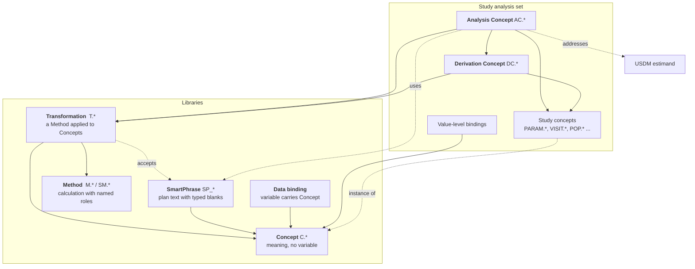

# 14. Quick reference

[Guide index](README.md) · Previous: [13. Describing your own analysis](13-describing-your-own-analysis.md)

Things to look up, and an honest account of what the candidate does not do.

## The model on one page

## The five layers

| Layer | One line | Never names | Chapter |
| --- | --- | --- | --- |
| SmartPhrase | A piece of SAP text with typed blanks | A variable | 8 |
| Method | A calculation with named roles and outputs | A Concept or a variable | 3 |
| Transformation | One Method applied to Concepts, with slices | A variable | 5 |
| Concept | A meaning: collected, derived or analysis | A Method or a variable | 4 |
| Implementation | Data bindings (variables) and code | — | 6 |

## Identifier prefixes

| Prefix | Kind | Example |
| --- | --- | --- |
| `M.` | Method | `M.ANCOVA` |
| `SM.` | Sub-method (one output of a Method) | `SM.ANCOVA.LsMeans` |
| `S.` | Statistic | `S.p_value` |
| `SS.` | Statistic set | `SS.ci_estimate_t_distribution` |
| `OC.` | Output class | `OC.ls_means` |
| `C.` | Concept | `C.Change` |
| `T.` | Transformation | `T.CFB_ANCOVA` |
| `SP_` | SmartPhrase | `SP_CFB_ENDPOINT` |
| `AC.` | Analysis Concept (in a study) | `AC.PRIMARY.ADASCOG` |
| `DC.` | Derivation Concept (in a study) | `DC.CHG.ADASCOG11.WK24` |
| `PARAM.`, `VISIT.`, `POP.`, `TRT.`, `EVENT.`, `ICE.` | Study concepts | `POP.EFFICACY` |
| `EST.` | Estimand reference | `EST.PRIMARY` |

The study prefixes (`AC.`, `DC.`, `PARAM.` …) are the convention of the
examples, not a rule of the model.

## Where to find things

| What | File |
| --- | --- |
| Methods | `v1/lib/methods/analyses/*.json`, `v1/lib/methods/derivations/*.json` |
| Statistics, statistic sets, output classes | `v1/lib/statistics/` |
| Concepts | `v1/lib/concepts/concepts.json` |
| Transformations | `v1/lib/transformations/transformations.json` |
| SmartPhrases, roles, language packs | `v1/lib/smartphrases/smartphrases.json` |
| ADaM and SDTM bindings | `v1/lib/bindings/` |
| SAS and R call templates | `v1/lib/implementations/` |
| A study | `v1/studies/<study>/analysis_set.json` |
| The formal model | `v1/schema/*.yaml`; every class and property in [model-reference.md](../model-reference.md) |

## Commands

| To … | Run |
| --- | --- |
| Check everything | `python -m pytest v1/tests -q` |
| Validate libraries and studies | `python v1/tools/validate.py` (add `--all` for warnings) |
| Generate analysis sentences | `python v1/tools/render.py <study> [en\|fr\|de]` |
| Show derivation order and variables | `python v1/tools/resolve.py <study> [analysis]` |
| List the variables the analyses need | `python v1/tools/downstream.py <study> adam` |
| Analysis results metadata and program calls | `python v1/tools/downstream.py <study> arm [analysis]` |
| Statistics available for a table | `python v1/tools/downstream.py <study> shell [analysis]` |

## Words that changed

Presentations and older branches use other names. They mean the same things.

| You may read | Here it is |
| --- | --- |
| AC/DC, ACDC | Analysis Concepts (AC) |
| Template, recipe | Transformation |
| Semantic Transformation Concept, Transformation Element, DataConcept | Concept |
| Observation Concept, Derivation Concept (as a library entry) | A `collected` or `derived` Concept |
| Result pattern | An `analysis` Concept |
| Building block, Smart Phrase | SmartPhrase |
| Cube | Data structure |
| Filter | A slice on the population dimension |

Note the two meanings of "Derivation Concept" and "Analysis Concept". In the
library, a *Concept* is a meaning (`C.Change`, `C.LSMeans`). In a study, an
*Analysis Concept* or *Derivation Concept* is a Transformation in use
(`AC.PRIMARY.ADASCOG`). This guide uses the capitalised two-word names only for
the study sense. A full glossary is in [glossary.md](../glossary.md).

## Questions

**Is this a CDISC standard?**
No. It is a candidate, proposed for review by the CDISC Analysis Concepts
working group. Nothing here has been agreed.

**Do I have to write JSON by hand?**
For now, yes. The model is designed for tools to write. A demo application on
another branch has an authoring interface for an earlier version of the model.

**Does it replace my SAP?**
No. It can generate the sentences that specify analyses. The rest of the SAP
is prose.

**Does it replace ADaM or define.xml?**
No. It says which variables the analyses need and how they are derived, and it
holds what analysis results metadata records. The datasets and define.xml are
still produced, by you or by tools that read this.

**Does it run my analyses?**
Not in this repository. It can fill in a program call for some methods
(chapter 12). The calls are illustrative.

**Can I use it with non-CDISC data?**
The design allows it: only data bindings would differ. Candidate v1 has
bindings for ADaM and SDTM only.

**Who decides which analysis to use?**
The statistician. The model records the decision exactly; it does not make it.

**What does `illustrative` mean on an identifier?**
The identifier looks like a real USDM, ARS or terminology identifier but is not
registered anywhere. The example studies need something to point at, and the
real identifiers do not exist yet. Treat them as placeholders.

**What does `provisional` mean on a library entry?**
It was proposed during earlier project work and has not been reviewed. The
Kaplan-Meier template, the intercurrent-event phrases and two Concepts are
provisional.

## What the candidate cannot do yet

Read this before relying on it. The full list is in [gaps.md](../gaps.md).

| Limit | What it means for you |
| --- | --- |
| **Nothing has been reviewed** by the working group or by a statistician | Treat method definitions, especially model terms and parameters, as drafts |
| **The CDISC Pilot example is simplified** | The published primary analysis also adjusts for site, treats dose as continuous for a dose-response test, and runs pairwise comparisons only if that test is significant. The example has none of these |
| **Conditional analyses cannot be expressed** | "If the test is significant, then …" has no representation |
| **A treatment dose as a continuous covariate** has no template | The method layer could support it; no Transformation does |
| **Analyses with no method** (a listing, a simple subset) | Not yet allowed |
| **Three intercurrent-event strategies** have no implementation | Only treatment policy and hypothetical work end to end, and the hypothetical one uses LOCF, which is open to question |
| **No time-to-event derivations** | Time to event and censoring are read as given |
| **Kaplan-Meier has no confidence-level setting** | A stated 90% interval is in the text but not in the method's configuration |
| **Hypothesis tests are modelled as model-based methods** | A modelling compromise that may change |
| **Analysis concepts are specific to one test distribution** | Outputs based on z or chi-squared statistics often have no Concept to bind to |
| **Codes are mostly missing** | Few NCIt codes; no registered identifiers for estimand strategies |
| **SAS and R call templates are out of date** | 33 warnings; calls exist for a minority of methods |
| **No ARS, define.xml or full ADaM specification output** | The information is there; the writers are not |
| **French and German text is not validated** | Illustrative translations |

## Where to go from here

| If you want … | Read |
| --- | --- |
| The model in full | [overview.md](../overview.md), then [model-reference.md](../model-reference.md) |
| Both example studies, with generated output | [worked-examples.md](../worked-examples.md) |
| Every validation rule | [conformance.md](../conformance.md) |
| Why the model is the way it is | [decisions.md](../decisions.md) |
| How it was assembled, and the findings | [migration-notes.md](../migration-notes.md) |
| What is missing | [gaps.md](../gaps.md) |

[Back to the guide index](README.md)
