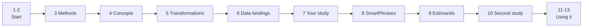

# Analysis Concepts — implementation guide

A step-by-step guide for statistical programmers. It assumes you know SDTM,
ADaM, define.xml, SAPs and TFL shells. It assumes nothing about Analysis
Concepts.

By the end you will be able to read a study described in Analysis Concepts,
describe an analysis of your own, and see how the description can drive the
SAP text, the ADaM specification, define.xml and the table shells.

> **Status.** This guide describes *candidate v1*, a proposal that the CDISC
> working group has not yet reviewed. The model, the libraries and the examples
> are real and are checked by tests, but details will change. Where something
> is missing or uncertain, the guide says so.

## How to read it

Read the chapters in order. Each one adds one idea to the ones before, and
each uses the same analysis: the primary efficacy analysis of the CDISC Pilot
study. Nothing is used before it is explained.

| Part | Chapter | You will learn |
| --- | --- | --- |
| **Start** | [1. Getting started](01-getting-started.md) | What Analysis Concepts is, and how to run the examples |
| | [2. One analysis, five artefacts](02-one-analysis-five-artefacts.md) | The running example, in the documents you already use, and why it is a problem |
| **The model, one layer at a time** | [3. Methods](03-methods.md) | How a calculation is described without naming any data |
| | [4. Concepts](04-concepts.md) | How the meaning of data is described without naming any variable |
| | [5. Transformations](05-transformations.md) | How a Method and Concepts are joined into a reusable derivation or analysis |
| | [6. Data bindings](06-data-bindings.md) | How Concepts are tied to your ADaM and SDTM variables |
| **A study** | [7. Your study](07-your-study.md) | How a study uses the libraries: Analysis Concepts and Derivation Concepts |
| | [8. SmartPhrases](08-smartphrases.md) | How the SAP text is generated from the same description |
| | [9. Estimands](09-estimands.md) | How estimands and intercurrent events are handled |
| | [10. A second study](10-a-second-study.md) | A time-to-event example, to show what is reused and what changes |
| **Using it** | [11. Other CDISC standards](11-other-standards.md) | How it fits with USDM, SDTM, ADaM, define.xml and ARS |
| | [12. Automation](12-automation.md) | What can be generated from a study description, and what cannot yet |
| | [13. Describing your own analysis](13-describing-your-own-analysis.md) | A worked exercise, with the errors you will meet |
| **Reference** | [14. Quick reference](14-quick-reference.md) | Identifiers, files, commands, questions and limits |

## Conventions

- `M.ANCOVA`, `C.Change`, `T.CFB_ANCOVA`: identifiers in the libraries. The
  prefix says what kind of thing it is (chapter 14 lists them all).
- Files are given relative to the repository root, for example
  `v1/lib/methods/analyses/M.ANCOVA.json`.
- JSON shown in the guide is copied from the committed files. Long files are
  shortened, and `…` marks what was left out.
- Data values in example datasets and table shells are **made up**. Dataset and
  variable names are the ones the example study uses.

## If you only have ten minutes

Read [chapter 2](02-one-analysis-five-artefacts.md), then the diagram at the
top of [chapter 7](07-your-study.md), then
[chapter 12](12-automation.md).
