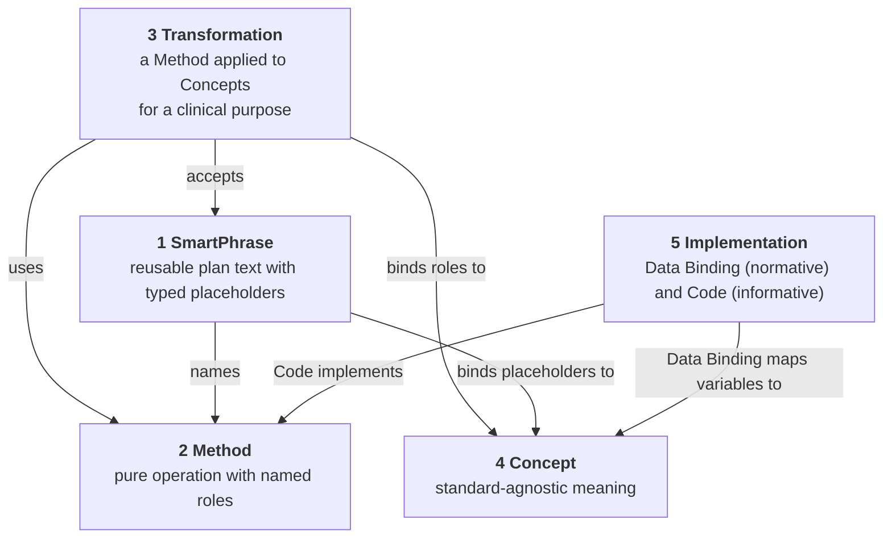

# Analysis Concepts candidate v1 — overview

> New to Analysis Concepts? The [implementation guide](guide/README.md) walks
> through the model step by step, starting from a SAP sentence, a table shell
> and an ADaM dataset.

Analysis Concepts (AC) is a model for saying, in a form a machine can read, how
clinical trial data is derived and analysed. It sits between the study
definition (USDM), which states the question, and the analysis results (ARS),
which hold the answer. It is independent of any one data standard or
programming language.

Every derivation and every analysis has the same shape: an output is a method
applied to inputs. AC separates that shape into five layers.

## The five layers

| # | Layer | What it is | References | Must not reference |
| --- | --- | --- | --- | --- |
| 1 | SmartPhrase | A reusable fragment of analysis plan text with typed placeholders, playing one role in a sentence. Text is generated from the model, never parsed | Concepts, Methods, method outputs | Physical variables |
| 2 | Method | A pure operation with named input roles, configurations and outputs. Model-based methods carry a statistical model and sub-methods | Statistics, statistic sets, output classes | Concepts, Transformations, variables |
| 3 | Transformation | One Method applied for a stated purpose. It binds Concepts to the Method's roles and outputs, and declares the input and output data structures, with the slices that subset them. Either a derivation (subject-level output) or an analysis (aggregate output) | One Method, Concepts, SmartPhrases | Physical variables |
| 4 | Concept | A meaning that Transformations reference and Data Bindings map to. Collected (no definition), closed-form (an algebraic identity) or method-bound (a contract a method output satisfies) | Other Concepts; statistics and output classes | Methods, Transformations, variables |
| 5 | Implementation | Data Binding: which variable of a standard carries a Concept, and when. Code: how a Method is run in a language | Concepts, Methods | — |

The first four layers are abstract and language-neutral. Implementation is the
only physical layer. Because every reference to data goes through a Concept,
supporting another data standard adds Data Bindings and changes nothing else.

Each layer has a library, published and versioned, and each library entry has a
status (`released`, or `provisional` for content proposed during this build).

## The study side

A study does not copy the libraries. It holds a **study analysis set**
(`v1/studies/<study>/analysis_set.json`), which pins the library versions it
uses and contains:

- **study concepts** — the study's parameters, visits, populations, treatments,
  events and intercurrent events, each an instance of a library Concept and
  each pointing at its definition in USDM or a terminology;
- **Derivation Concepts** — derivation Transformations as used in the study;
- **Analysis Concepts** — analysis Transformations as used in the study. Each
  names its template, the values that fill the template's placeholders, the
  estimand it addresses, how every intercurrent event in that estimand's scope
  is handled, and the SmartPhrases that describe it;
- **value-level data bindings** — where a variable carries a Concept only for
  one parameter.

An Analysis Concept is therefore not a library entry. It is a library
Transformation, used: `AC.PRIMARY.ADASCOG` is `T.CFB_ANCOVA` with the parameter
ADAS-Cog (11), the visit Week 24, the efficacy population, and so on.

## How the layers connect

Three paths run through the model. Each is exercised by a reference tool and a
test.

1. **Specification to data.** A Method role is bound by a Transformation to a
   Concept; a Data Binding maps the Concept to a variable; the study's concepts
   supply the conditions.
   `response → C.Change → ADQSADAS.CHG WHERE PARAMCD = 'ACTOT' AND AVISITN = 24 AND ITTFL = 'Y'`
   (`python v1/tools/resolve.py cdiscpilot01`)
2. **Analysis to derivation.** An analysis depends on the derivations that
   produce its inputs, and they on theirs, giving the order in which they must
   run and the analysis datasets the study needs.
   `DC.BASELINE.ADASCOG11 → DC.LOCF.ADASCOG11 → DC.CHG.ADASCOG11.WK24.LOCF`
3. **Model to text.** The SmartPhrases of an Analysis Concept, with their
   bindings, generate the analysis sentence in any language that has a language
   pack. (`python v1/tools/render.py cdiscpilot01 fr`)

The data structures of a Transformation follow the W3C Data Cube vocabulary:
dimensions identify observations, measures are computed on, and a slice fixes
dimension values. Population is a dimension fixed by a slice; there is no
separate filter.

## Where AC sits among other standards

| Standard | Owns | How AC relates |
| --- | --- | --- |
| USDM | Objectives, endpoints, estimands, intercurrent events, arms, visits, populations | Referenced, never changed. An Analysis Concept points at the estimand it addresses |
| ICH E9(R1) | Estimand attributes and intercurrent-event strategies | The five strategies and the analysis roles are enumerations. Each Analysis Concept states how each intercurrent event is handled |
| Biomedical Concepts and Dataset Specialisations | The meaning of collected data | Parameter values come from Biomedical Concepts. Data Bindings follow the Dataset Specialisation pattern; SDTM bindings refer to the published specialisations |
| SDTM, ADaM | Tabulated and analysis-ready data | Targets of Data Bindings. Candidate v1 binds CDISC standards only |
| ARS | Reporting events, analyses, results | An Analysis Concept points at the ARS analysis it corresponds to. Output data structures describe what results a Method produces |
| An eSAP model | Document structure, free text, reporting events, hypotheses, multiplicity, how intercurrent events are detected | Outside AC. It builds on the study analysis set and the SmartPhrase layer by referencing their entities by identifier (see `esap-extension.example.json` in each study) |

External vocabularies: W3C Data Cube (data structures), STATO and NCIt
(codings), FHIR R5 datatypes (value types), Wilkinson–Rogers notation (model
formulas).

## Where to go next

| To … | Read |
| --- | --- |
| See every class and property | [model-reference.md](model-reference.md) |
| Follow two studies end to end | [worked-examples.md](worked-examples.md) |
| Understand the checks | [conformance.md](conformance.md) |
| See what changed from the source branches, and why | [migration-notes.md](migration-notes.md) |
| See the decisions behind the model | [decisions.md](decisions.md) |
| See what is missing | [gaps.md](gaps.md) |
| Look up a term | [glossary.md](glossary.md) |
